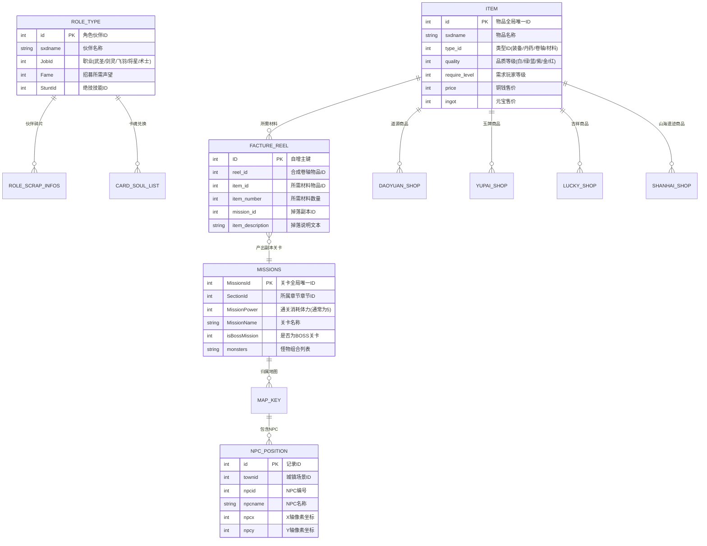

# 神仙道官方静态元数据库 (`data/gamedata.db`) 数据字典

> [!NOTE]
> 本文档定义了 `sxd-auto` 本地挂载的 `data/gamedata.db`（SQLite 3 数据库，通过 `scripts/rebuild_dict.py` 直接从官方客户端 `cur_ver=2026112001` 的 `Main.swf` / `templet.swf` 从零反编译构建，共 35 张官方静态表、20,126 行）的完整实体关系图、数据字典与 Go 数据仓储（`internal/dictionary`）映射规范。

---

## 一、 实体关系全景图 (Entity-Relationship Diagram)



---

## 二、 35 张官方 SWF 静态表全量分类索引

| 业务领域分类 | 包含表名 | 记录条数 | 自动化业务用途与职责 |
| :--- | :--- | :--- | :--- |
| **物品、装备与配方** | `item` *(核心运行)* | 10,016 | 全局物品元数据字典（装备、丹药、材料、礼包；来自 `ItemTypeData.Items`） |
| | `factureReel` | 2,409 | 卷轴合成配方及材料关卡掉落映射（来自 `FactureReelType._factureReelList`） |
| | `FiveElementsEquip` | 15 | 五行装备阶数、属性及分解经验规则（来自 `FiveElementsType.ElementEquipList`） |
| | `DragonBall` | 68 | 龙珠技能、星级与解封消耗龙魂字典（来自 `DragonBallType.DragonBall`） |
| | `DragonBallResource`| 6 | 龙珠强化与分解资源定义（来自 `DragonBallType.DragonBallResource`） |
| | `TowerAwardList` | 8 | 爬塔积分兑换奖励配置（来自 `ServerTowerType.scoreAwardList`） |
| **关卡、寻路与任务** | `Missions` *(核心运行)* | 2,003 | 全量副本地图关卡、体力消耗与怪物编队（来自 `MissionTypeData` + `MissionMonsterTypeData`） |
| | `Quests` *(核心运行)* | 1,937 | 主线、支线与日常任务接取/交付 NPC 字典（来自 `QuestTypeData.Quests`） |
| | `NPCposition` *(核心运行)* | 530 | 全城镇 NPC 编号、名称与二维坐标字典（来自 `TownTypeData` + `TownNPCType` + `NPCType`） |
| | `NPCQuest` *(核心运行)* | 20 | NPC 结交每日问答与最优选项/奖励（来自 `NpcFriendShipType.QuestList`） |
| | `beelzebub_boss` *(核心运行)* | 155 | 魔王试炼 Boss 名称、开放等级、累计上限与神秘层标记（来自 `BeelzeBubTrialsBossType.Bosses`） |
| | `functions` *(核心运行)* | 300 | 游戏功能开放 ID、标识与开放等级字典（来自 `FunctionTypeData.List`） |
| | `Mapkey` | 149 | 城镇地图标识与名称映射字典（来自 `TownTypeData.Towns`） |
| | `ImmortalFantasy` | 59 | 虚空幻境副本序列与掉落配置（来自 `ImmortalFantasyType.immortalFantasyStage`） |
| **角色、伙伴与养成** | `roletype` *(核心运行)* | 939 | 全伙伴基础属性、职业、招募声望与绝技（来自 `RoleType.Roles`） |
| | `faxiang_pray_award` *(核心运行)* | 14 | 主角法相造物佛手祈愿炼化奖励与道缘/经验配置（来自 `MainRoleFaXiangType.extraPrayAwardList`） |
| | `fatetype` | 115 | 命格品质、战斗属性加成与升级规则（来自 `FateTypeData.Fates`） |
| | `cardSoulList` | 72 | 伙伴卡魂兑换与分解碎片比率（来自 `CardSoulType.cardSoulCardList`） |
| | `soulList` | 120 | 灵件属性与名称配置（来自 `SoulTypeData.Soul`） |
| | `RoleScrapInfos` | 40 | 特殊神级伙伴碎片兑换需求（来自 `RoleType.RoleScrapInfos`） |
| | `PlayerTitles` | 290 | 玩家称号及获取来源说明（来自 `PlayerTitleType.PlayerTitles`） |
| | `PartnerExpeditionmission` | 8 | 伙伴远征派遣任务星级与奖励（来自 `PartnerExpeditionType.missionList`） |
| **商店、兑换与集市** | `wishpoolaward` *(核心运行)* | 49 | 天帝宝库自选大奖条目与品质/排序/功能开放 ID（来自 `TreasureHouseTypeData.objHouseAward`） |
| | `daoyuanshop` | 71 | 道源商店物品、限购数量与货币定价（来自 `StDaoYuanShopType.DaoYuanData`） |
| | `StShanhaiShop` | 14 | 山海遗迹积分商店物品与每日限购（来自 `StShanHaiRelicTypeData.shopArray`） |
| | `newShopGoods` | 19 | 游历商店货架配置（来自 `StTravelShopType.newShopGoods`） |
| | `WorldPKExchange` | 6 | 跨服战积分兑换奖池（来自 `WorldPkRankingType.WorldExchangeArray`） |
| | `IdentifyTreasureaward` | 37 | 鉴宝活动奖励表（来自 `IdentifyTreasureTypeData.awardList`） |
| **日常活动与社交** | `ActivityArray` | 408 | 全局限时活动标识与活动名称对照（来自 `ActivityTemplate.ActivityArray`） |
| | `ChallengeType` | 102 | 怪物阵型与挑战词条定义（来自 `StChallengeType.MissionMonsterTeamSpecialPattern`） |
| | `MascotBefall` | 26 | 福神降临 Buff 类型定义（来自 `MascotBefallType.MascotBefallArr`） |
| | `StEightImmortalsType` | 24 | 八仙过海活动规则与属性配置（来自 `StEightImmortalsType.EightImmortalsRules`） |
| | `Furinkazan` | 26 | 风林火山活动关卡阶段配置（来自 `FurinkazanType.missionLineList`） |
| | `serchat` | 19 | 闲聊频道分流服务器配置（来自 `ServerChatRoomType.ChatRooms`） |
| | `relicPoint` | 52 | 山海遗迹节点与路径映射（来自 `StShanHaiRelicTypeData.relicPointArray`） |
| **构建元数据** | `_rebuild_meta` | 38 | 记录最近一次 SWF 反编译构建的 `cur_ver`、时间与全部 35 张表行数 |

---

## 三、 核心业务表详述 (Core Schemas)

### 3.1 物品字典表 (`item`)
全游戏静态资产基石，所有商店、掉落、扫荡均通过 `id` 进行关联：

```sql
CREATE TABLE item (
    id            INTEGER PRIMARY KEY, -- 物品唯一标识
    sxdname       TEXT    NOT NULL,    -- 物品名称 (如 "气血包", "紫幽羽")
    type_id       INTEGER NOT NULL,    -- 物品类型码 (装备=1~6, 丹药=10001, 卷轴=11000 等)
    description   TEXT,                -- 描述说明文本
    quality       INTEGER NOT NULL,    -- 品质 (0=白, 1=绿, 2=蓝, 3=紫, 4=金, 5=暗金, 6=红)
    require_level INTEGER DEFAULT 1,   -- 佩戴/使用最低角色等级
    price         INTEGER DEFAULT 0,   -- 卖店铜钱价格
    ingot         INTEGER DEFAULT 0,   -- 商城元宝定价
    special_gift_tip TEXT              -- 特殊礼包打开提示
);
```

### 3.2 副本关卡字典表 (`Missions`)
驱动自动扫荡、主线推图与体力消耗计算的核心表：

```sql
CREATE TABLE Missions (
    MissionsId    INTEGER PRIMARY KEY, -- 关卡唯一标识 (如 1="浮月林道(1)", 105="扬州城-万妖皇")
    SectionId     INTEGER NOT NULL,    -- 章节序号 (1=小渔村, 2=苏州城, 3=京城...)
    MissionLock   INTEGER DEFAULT 0,   -- 解锁所需前置任务标记
    MissionPower  INTEGER DEFAULT 5,   -- 单次挑战消耗体力 (标准为 5 点)
    map           INTEGER,             -- 地图背景资源编号
    mapkey        INTEGER,             -- 关联 Mapkey 城镇索引
    MissionName   TEXT    NOT NULL,    -- 关卡全名
    MissionType   INTEGER DEFAULT 0,   -- 关卡类型 (0=普通关卡, 1=精英副本)
    isBossMission INTEGER DEFAULT 0,   -- 是否为章节 BOSS 关卡 (1=是, 0=否)
    monsters      TEXT                 -- 怪物组合字符串 (如 "1,2,3")
);
```

### 3.3 卷轴材料合成表 (`factureReel`)
驱动“智能材料扫荡”的关键推导表。当用户指定打造某件紫装/金装时，算法以此表自动推导所需刷取的关卡：

```sql
CREATE TABLE factureReel (
    ID               INTEGER PRIMARY KEY AUTOINCREMENT,
    reel_id          INTEGER NOT NULL, -- 卷轴本身的物品 ID (关联 item.id)
    item_id          INTEGER NOT NULL, -- 所需基础合成材料物品 ID (关联 item.id)
    item_number      INTEGER NOT NULL, -- 所需材料数量
    item_description TEXT,             -- 掉落说明 (如 "幽花林(1)掉落")
    mission_id       INTEGER NOT NULL  -- 产出该材料的最佳关卡 ID (关联 Missions.MissionsId)
);
```

### 3.4 城镇 NPC 坐标表 (`NPCposition`)
驱动跨图移动与自动 NPC 交互（交接任务、仙境结交、进入副本）的空间坐标字典：

```sql
CREATE TABLE NPCposition (
    id      INTEGER PRIMARY KEY,
    townid  INTEGER NOT NULL, -- 城镇城镇编号 (1=小渔村, 2=苏州, 5=扬州...)
    npcid   INTEGER NOT NULL, -- NPC 角色编号
    npcname TEXT    NOT NULL, -- NPC 姓名 (如 "村长", "芸娘", "神秘商人")
    npcx    INTEGER NOT NULL, -- 二维 X 轴像素绝对坐标
    npcy    INTEGER NOT NULL  -- 二维 Y 轴像素绝对坐标
);
```

---

## 四、 Go 语言工程接入规范 (`internal/dictionary`)

在 Go 项目中通过纯 Go SQLite 驱动（避免跨平台 CGO 编译依赖）挂载 `data/gamedata.db`：

1. **只读挂载保护**：
   ```go
   // 必须使用只读模式打开，防止多进程写入引发 SQLite 锁死或原版资产损坏
   dbURI := "file:data/gamedata.db?mode=ro&cache=shared"
   db, err := sql.Open("sqlite", dbURI)
   ```
2. **内存热缓存策略**：
   - 数据量较小的字典（如 `NPCposition`、`fatetype`、`DragonBall`、`Mapkey`）在系统启动时一次性加载为 `map[int]*Entity`，实现 $O(1)$ 寻址。
   - 数据量较大的 `item`（10,016 条）与 `factureReel`（2,409 条）建立主键及索引按需检索。

---

## 五、 官方 SWF 自动重建流水线 (`scripts/rebuild_dict.py`)

为避免静态库随游戏版本更新而过期，项目提供零外部依赖的纯 Python 提取工具 [rebuild_dict.py](../scripts/rebuild_dict.py)：

1. **获取线上最新版本号**：运行 `go run -tags=probe test/probes/probe_ticket_extra.go` 读取 `cur_ver` 与 `diff_urls[cur_ver]`。
2. **拉取并反编译重建**：
   ```bash
   python3 scripts/rebuild_dict.py --ver <cur_ver> --diff <diff_tag>
   ```
   脚本会按官方 CDN 目录树规则下载 `Index.swf`、`Main.swf` 与 `templet.swf`，通过内建 AVM2 DoABC 常量池与 `cinit` 字节码求值器提取全部 35 张官方静态表并从零构建全新 `data/gamedata.db`（临时文件写入 + `VACUUM` + 原子替换），同时写入 `_rebuild_meta` 追踪版本。
3. **验证回归**：执行 `go test -race -count=1 ./internal/dictionary ./internal/qa` 确认全部查询与题库校验通过。
