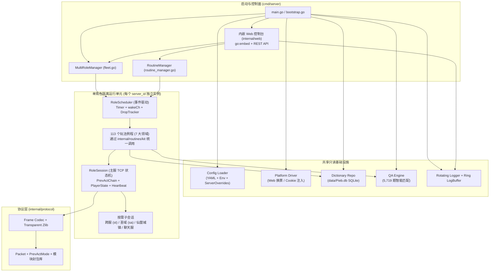
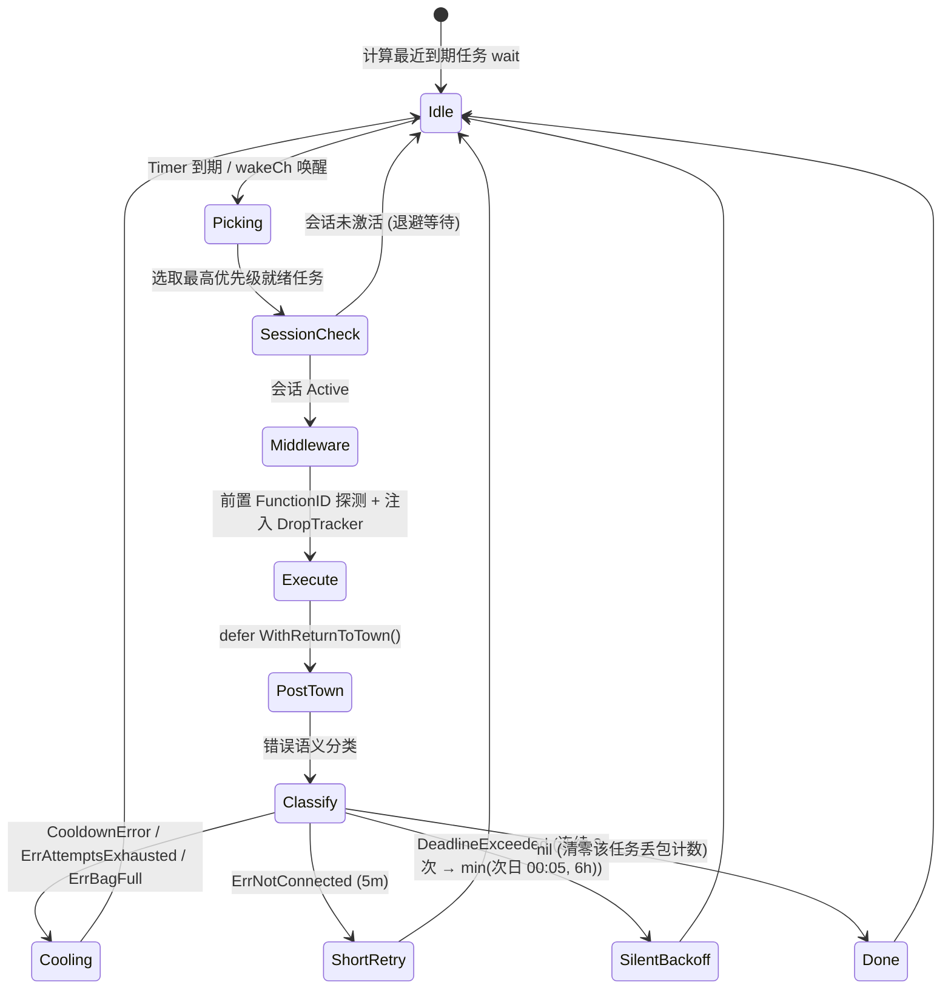

# 系统架构与详细设计文档 (Design Document)

> 本文档面向研发与维护人员，描述 `sxd-pie-ng` 完成 Phase 0~4 工程化重构后的整体架构、核心状态机、并发模型、协议与调度原语以及扩展规范。

---

## 1. 系统总体架构

`sxd-pie-ng` 采用**单进程多角色隔离架构**：每个配置的角色在进程内拥有独立的网络长连接会话（`RoleSession`）与独立的事件驱动调度器（`RoleScheduler`），共享只读的离线元数据仓储（`Pieb.db`）、问答引擎（`qa.Engine`）与内嵌 Web 管理面（`web.Server`）。

### 1.1 核心设计原则
1. **单角色故障隔离**：每个角色独立持有 `RoleSession`、`RoleScheduler` 与 `DropTracker`，任一区服断线、超时或静默丢包不会阻塞或污染其他区服。
2. **零外部运行时依赖**：前端静态资源通过 `go:embed` 编入二进制，SQLite 使用纯 Go 驱动挂载 `data/Pieb.db`，单二进制即可部署。
3. **协议精确对齐与回包解析铁律（ADR-0015）**：严禁以“未超时”判定业务成功，所有业务请求必须解析结果码并按失败语义驱动熔断/冷却。
4. **元宝安全红线**：自动化默认只消耗免费次数、铜钱、道缘等常规资源；所有涉及元宝的入口（清冷却、买次数、高级抽奖、元宝培养等）默认禁止调用。

---

## 2. 分层模块职责

### 2.1 网络会话层 (`internal/client`)
经过 Phase 2 职责拆分后，`internal/client` 按单一职责组织为以下核心文件：

| 文件 | 核心职责 |
| :--- | :--- |
| [session.go](file:///home/chang/sxd/internal/client/session.go) | `RoleSession` 生命周期状态机（`Disconnected`/`Connecting`/`Authenticating`/`Active`/`Closed`）、`Send`/`Call`/`CallWithPrevActResync`、心跳保活、指数退避重连与 `callTimeout` 辅助 |
| [prevact.go](file:///home/chang/sxd/internal/client/prevact.go) | 并发安全的 `PrevActChain` 状态机：统一管理业务尾链锚点、失步标记（`chainDirty`）、最近 32 条收包环形诊断缓冲与载荷覆写 |
| [player_state.go](file:///home/chang/sxd/internal/client/player_state.go) | `PlayerState` 资产快照、下行属性推送解析（`update_player_data`）、`FetchLatestPlayerInfo` 与 `SyncQuests` |
| [gateway_auth.go](file:///home/chang/sxd/internal/client/gateway_auth.go) | `DefaultGatewayAuthenticator` 四步登录握手与全量角色资产初始化 |
| [town_practice.go](file:///home/chang/sxd/internal/client/town_practice.go) | 主城切换（`EnterTown`/`ReturnToTown`）与城镇打坐练功协议封装 |
| [beelzebub_session.go](file:///home/chang/sxd/internal/client/beelzebub_session.go) / [beelzebub_trials.go](file:///home/chang/sxd/internal/client/beelzebub_trials.go) | 魔王试炼（Mod 57）会话封装、组队与自动挑战编排 |
| [tower_actions.go](file:///home/chang/sxd/internal/client/tower_actions.go) | 六道轮回塔（Mod 32）与背包物品出售封装 |
| [cross_server.go](file:///home/chang/sxd/internal/client/cross_server.go) / [saint_area.go](file:///home/chang/sxd/internal/client/saint_area.go) / [sect_town.go](file:///home/chang/sxd/internal/client/sect_town.go) / [server_chat_room.go](file:///home/chang/sxd/internal/client/server_chat_room.go) | 按需建立与回收的跨服（仙界）、圣域、仙盟城镇与独立聊天服子会话 |
| [mock_server.go](file:///home/chang/sxd/internal/client/mock_server.go) | 供离线调试、沙箱与单元测试使用的虚拟协议服务端 `runMockGameServer` |

### 2.2 协议编解码与 PrevAct 链状态机 (`internal/protocol` + `internal/client/prevact.go`)
1. **帧格式与流式解压**：
   - 物理帧固定 8 字节大端头：`[4B Length][2B ModuleID][2B ActionID]` + 变长 Payload。
   - 下行 Payload 若首字节为 `0x78`（zlib CMF 魔数），由 `DecompressPayloadIfNeeded` 自动尝试透明解压，解压失败时安全降级为原始字节。
2. **统一 `PrevActMode` 契约**（[packet.go](file:///home/chang/sxd/internal/protocol/packet.go)）：
   - `PrevActNone`：不携带尾链（保留历史 Mod 3/4/32 兼容兜底）。
   - `PrevActAutoBusiness`：发送瞬间由 `PrevActChain.StampPayload` 自动填充最新业务动作锚点（兼容旧 `HasPrevAct` / `PrevActFromLastSent`）。
   - `PrevActExplicit`：使用调用方显式写入的锚点，发送层**绝不覆盖**（用于重同步重试与特定跨模块锚点）。
3. **链污染自愈与重同步**：
   - 心跳包（`0x0000004B`）与服务端异步推送不污染 `lastBusinessActionID`。
   - 当带尾链请求超时（疑似被服务端静默丢弃），`Call()` 标记 `chainDirty = true`，后续请求自动回退到服务端最后确认动作 `lastAckActionID`，直至收到新业务回包清除脏标记。
   - `CallWithPrevActResync` 仅在 `context.DeadlineExceeded` 且上层未取消时，使用 `PrevActExplicit` 以最新锚点重试一次；遇到断线/关闭/取消直接透传错误。
4. **模块化协议文件**：Phase 4 已将原超千行的 `feature_packets.go` 与 `activity_expansion.go` 拆分为按游戏模块独立的协议文件（`online_gift.go`、`jieyuan_box.go`、`caravan.go`、`demon_tower.go`、`treasure_house.go`、`bailian.go`、`partner_practice.go`、`era_creation.go`、`cultivation_card.go` 等），全目录无超千行巨文件。

### 2.3 事件驱动调度器与横切中间件 (`internal/scheduler`)

- **零忙轮询事件驱动**（[scheduler.go](file:///home/chang/sxd/internal/scheduler/scheduler.go)）：`pickNextReadyOrWait()` 在锁内计算最高优先级可执行项或精确等待时长，通过 `time.NewTimer(wait)` 休眠；`Register`、`SetRoutineEnabled(..., true)`、`TriggerBatch` 通过非阻塞 `wakeCh` 立即唤醒调度循环。
- **语义化优先级阶段**（[routine.go](file:///home/chang/sxd/internal/scheduler/routine.go)）：禁止魔数优先级，统一使用 `PhasePriority(phase, offset)`：
  - `PhaseSystem (500)`：会话维护（如 5 分钟主动重建连接）
  - `PhaseTownSensitive (420)`：对城镇上下文极敏感的玩法（天帝宝库、灵域猎妖）
  - `PhaseEarlyBattle (350)`：长会话后段易丢包的战斗/养成（五行天宫、无量劫海、飞升、魔界远征、无尽洞天等）
  - `PhaseCoreLoop (300)`：核心循环（轮回图录等）
  - `PhaseEarlyWindow (200)`：早间窗口（结缘宝箱等）
  - `PhaseHighPriority (100)` / `PhaseStandard (50)` / `PhaseCleanup (10)`：常规日常与收尾清理
- **声明式横切选项**：
  - `WithReturnToTown(timeout...)`：玩法退出时自动回城，避免战斗场景残留污染后续玩法；
  - `WithFunctionID(id)`：执行前原生调用 `check_function_open`（Mod 0, Act 69）；
  - `WithSilentDropPolicy(threshold, retry)`：定制静默丢包退避阈值与短重试周期。
- **实例隔离 `DropTracker`**（[dropbackoff.go](file:///home/chang/sxd/internal/scheduler/dropbackoff.go)）：每个 `RoleScheduler` 独立持有 `drops *DropTracker` 并通过 `WithDropTracker(ctx, drops)` 注入上下文；玩法侧统一使用 `HandleSilentDropCtx` / `ResetSilentDropsCtx` / `NoteSilentDropCtx` / `SilentDropCountCtx`，彻底消除进程级全局状态串扰。

### 2.4 玩法调用原语与 7 大领域包 (`internal/routines`)
- **统一调用原语**（[caller.go](file:///home/chang/sxd/internal/routines/kit/caller.go)）：
  - `kit.NewCaller(ctx, session, defaultTimeout)` 统一管理超时上下文并保留 `LastErr()`；
  - `caller.AbortErr()` 与 `kit.IsAbortErr(err)` 将 `ErrNotConnected`、`ErrSessionClosed`、`context.Canceled` 统一识别为必须立即中止本轮的终止错误，防止断线被误当静默丢包吞掉；
  - `kit.Sleep(ctx, d)` 取代裸 `time.Sleep`，支持 `SIGINT` 毫秒级退出；
  - `kit.WithTimeoutOverride(ctx, d)` 允许单测将 8~45 秒业务超时压缩到毫秒级。
- **7 大领域包与注册工厂**（[registry.go](file:///home/chang/sxd/internal/routines/registry.go)）：
  - `system`（1 项）、`daily`、`dungeon`、`farming`、`minigame`、`pvp`、`social` 共 **113 个例程**，Phase 3 后全部按单玩法/单业务域拆分为内聚文件（无超 1,500 行文件）。

### 2.5 离线元数据 (`data/Pieb.db`) 与题库 (`internal/qa`)
- `internal/dictionary` 以只读模式挂载 `data/Pieb.db`，为主线推图（任务/NPC/关卡锁/怪物编队）、精英扫荡与背包清理（`Items.TypeID`/`Price`）、宗师修行（伙伴 `role_id` → `JobId`）、天帝宝库（道具品质与大奖权重）及药园日志翻译提供离线静态数据。
- `internal/qa` 启动时从 `Pieb.db` 预加载 5,719 道题库，服务仙旅奇缘与金榜题名自动答题。

---

## 3. 工程质量与扩展约定

新增玩法或协议时必须遵守：
1. **协议层**：明确声明 `PrevActMode`，解析器先校验结果码再读业务字段；
2. **玩法层**：使用 `kit.NewCaller` + `kit.Sleep` + `PhasePriority` + `*Ctx` 丢包接口；战斗/跨场景玩法声明 `scheduler.WithReturnToTown()`；
3. **测试层**：覆盖成功路径与至少一个失败码路径，通过 `go vet ./...` 与 `go test -race ./...`；
4. **逆向探针**：统一存放于 `test/probes/`，首行强制声明 `//go:build probe`，禁止硬编码真实凭据（ADR-0013）。
