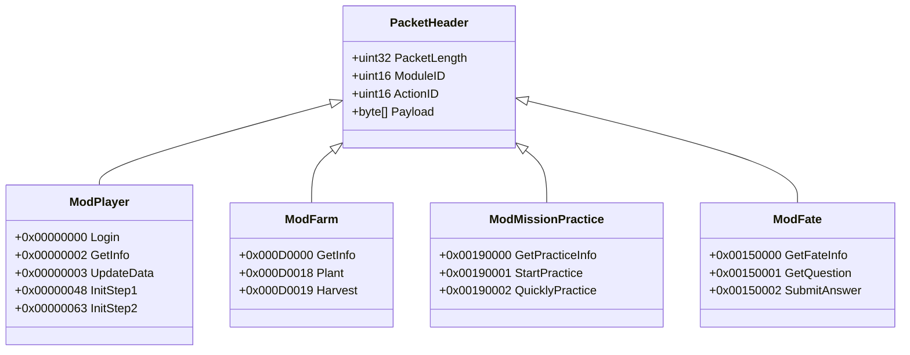

# 神仙道二进制网络协议规范白皮书 (Protocol Specification)

> [!NOTE]
> 本规范基于原版客户端（`pie.exe`）逆向推演与抓包文件 `sxd.pcapng`（5,328 条 TCP 交互封包）一手数据对齐编制。定义了客户端与游戏服务器、跨服服务器间通信的物理帧格式、数据类型编解码规则与 Golden Packet 黄金测试用例。

---

## 一、 协议层级与物理帧结构 (Frame Structure)

神仙道网络通信基于 **TCP 流式长连接**，应用层采用源自 ActionScript 3 ByteArray 的**大端序（Big-Endian / 网络字节序）私有二进制流协议**。

### 1.1 定长包头布局 (Header Layout)

每个通信封包以固定的 **8 字节包头** 起始，后接动态长度的应用层载荷（Payload）：

```
 0                   1                   2                   3
 0 1 2 3 4 5 6 7 8 9 0 1 2 3 4 5 6 7 8 9 0 1 2 3 4 5 6 7 8 9 0 1
+-+-+-+-+-+-+-+-+-+-+-+-+-+-+-+-+-+-+-+-+-+-+-+-+-+-+-+-+-+-+-+-+
|                       Packet Length (4B)                      |
+-+-+-+-+-+-+-+-+-+-+-+-+-+-+-+-+-+-+-+-+-+-+-+-+-+-+-+-+-+-+-+-+
|          Module ID (2B)       |          Action ID (2B)       |
+-+-+-+-+-+-+-+-+-+-+-+-+-+-+-+-+-+-+-+-+-+-+-+-+-+-+-+-+-+-+-+-+
|                                                               |
|                   Payload Data (Length - 4 Bytes)             |
|                                                               |
+-+-+-+-+-+-+-+-+-+-+-+-+-+-+-+-+-+-+-+-+-+-+-+-+-+-+-+-+-+-+-+-+
```

| 字段名称 | 字节大小 | 字节序 | 描述与约束 |
| :--- | :--- | :--- | :--- |
| **Packet Length** | 4 字节 (uint32) | Big-Endian | 载荷长度声明。等于后续字节总数（`2B Module + 2B Action + Payload 长度`）。TCP 粘包半包以此为界。 |
| **Module ID** | 2 字节 (uint16) | Big-Endian | 业务模块编号（如角色模块=0，副本扫荡=25，药园=13 等）。 |
| **Action ID** | 2 字节 (uint16) | Big-Endian | 模块内部指令编号（如登录握手=0，进入城镇=0，提交答案=2 等）。 |
| **Payload** | 可变长 | - | 具体指令参数序列，或经过透明 zlib 压缩的二进制流。 |

> [!IMPORTANT]
> **ActionID 合成规范**：在 Go 实现中，`uint32` 类型的统一 `ActionID` 由高 16 位 Module 与低 16 位 Action 组合而成：
> `ActionID = (uint32(Module) << 16) | uint32(Action)`

### 1.2 回包结果码解析契约（铁律）

大多数业务应答包在 ActionID 之后以结果码起始，随后才是业务字段：

```
[UByte result_code][业务字段 ...]
```

- **成功值因模块而异**：例如登录成功为 `4`、竞技场挑战为 `0`、跨服登录为 `2`、在线礼包为 `97`。必须依据本文档对应模块的协议定义判断，严禁统一假设 `0` 为成功。
- **先校验结果码，再解析业务字段**：失败回包可能被截断或不包含完整业务数据；在结果码未确认成功前，禁止读取或采信后续字段。
- **禁止丢弃回包**：任何发送业务请求的代码都必须持有响应并解析 `result_code`，禁止以“TCP 收到回包”或 `session.Call` 未返回错误判定业务成功。
- **失败必须驱动分支**：次数不足、冷却中、条件不满足、背包已满、未知错误码等必须映射为对应的熔断、挂起或退出动作，具体契约见 [routine-spec.md](./routine-spec.md) 2.2 节。

---

## 二、 基本数据类型序列化规范 (Type Marshalling)

Payload 中的字段无任何分隔符，严格按照指令接口签名紧凑排列：

### 2.1 基础数值类型 (Primitives)
- **`Int8 / UInt8`**：单字节直接读取。
- **`Int16 / UInt16`**：2 字节大端序（`binary.BigEndian.Uint16`）。
- **`Int32 / UInt32`**：4 字节大端序（`binary.BigEndian.Uint32`）。
- **`Int64 / UInt64`**：8 字节大端序。

### 2.2 变长字符串 (String)
- **编码格式**：前缀 2 字节无符号整数（表示 UTF-8 字节串长度），后随原始字节：
  ```
  [2 字节 Length (Big-Endian)] + [Length 字节的 UTF-8 文本]
  ```
- **示例**：字符串 `"kongyu"` 编码为 `00 06 6b 6f 6e 67 79 75`。

### 2.3 数组与列表 (Array / List)
- **编码格式**：前缀 2 字节（或根据接口定义的 4 字节）元素个数 `Count`，后随 `Count` 个相同结构的实体连续编码：
  ```
  [2 字节 Count] + [Item_1] + [Item_2] + ... + [Item_Count]
  ```

### 2.4 透明流式 zlib 压缩 (Compression Protocol)
当单包响应数据体较大（如大地图数据、全服公告、全量背包列表）时，服务端会对整个 Payload（或从 ActionID 之后的数据）执行标准 Deflate 压缩：
- **特征魔数**：首字节为 `0x78`（标准 zlib CMF 头部，常见 `0x78 0x9C`、`0x78 0x01`、`0x78 0xDA`）。
- **解码自愈契约**：客户端嗅探到 `0x78` 时尝试 `zlib.NewReader` 解压；若解压缩中途报错，降级为原始未压缩字节，防止非压缩数据的误判崩溃。

---

## 三、 基于真实抓包 (`sxd.pcapng`) 的黄金报文对照

以下测试用例直采自项目根目录下 `sxd.pcapng` 的真实网络流，作为 Go `protocol/codec.go` 单元测试的 Golden Cases。

### 3.1 客户端登录请求包 (Golden Case 1: Player Login)
- **抓包来源**：`192.168.3.6:9826 -> 49.232.196.100:8381`（Frame 1）
- **协议分类**：`Module 0` (Player), `Action 0` (Login)
- **原始报文字节流 (116 字节)**：
  ```hex
  00 00 00 70 00 00 00 00 00 06 6b 6f 6e 67 79 75
  00 20 38 62 33 61 39 34 61 62 39 33 33 62 33 36
  39 39 39 63 65 65 31 32 30 38 65 35 34 32 64 64
  39 31 00 00 00 00 67 06 82 89 00 00 00 00 00 20
  38 62 33 61 39 34 61 62 39 33 33 62 33 36 39 39
  39 63 65 65 31 32 30 38 65 35 34 32 64 64 39 31
  00 0c 66 65 6e 67 77 61 6e 79 78 5f 73 38 31 33
  00 02 77 64
  ```
- **逐字段解构剖析**：
  1. `00 00 00 70`：`Packet Length = 112`（后续 112 字节，整包 116 字节）。
  2. `00 00`：`Module ID = 0`（角色主模块）。
  3. `00 00`：`Action ID = 0`（登录指令）。
  4. `00 06 6b 6f 6e 67 79 75`：字符串 `Username = "kongyu"`（长度 6）。
  5. `00 20 38 62 33 61 ...`：字符串 `Hash = "8b3a94ab933b36999cee1208e542dd91"`（32 字节 MD5 凭据）。
  6. `00 00 00 00 67 06 82 89`：时间戳与校验参数。
  7. `00 20 ...`：第二重鉴权 Hash。
  8. `00 0c 66 65 6e 67 77 61 6e 79 78 5f 73 38 31 33`：区服标识字符串 `ServerID = "fengwanyx_s813"`（长度 12）。
  9. `00 02 77 64`：客户端标识字符串 `ClientType = "wd"`（微端模式，可领取专属奖励）。

### 3.2 服务端登录成功响应包 (Golden Case 2: Login Response)
- **抓包来源**：`49.232.196.100:8381 -> 192.168.3.6:9826`（Frame 5）
- **协议分类**：`Module 0` (Player), `Action 0` (Login Response)
- **原始报文字节流 (30 字节)**：
  ```hex
  00 00 00 1a 00 00 00 00 00 00 00 00 04 0a 00 00
  00 00 00 00 00 00 01 00 0b 00 00 10 85 01
  ```
- **逐字段解构剖析**：
  1. `00 00 00 1a`：`Packet Length = 26`。
  2. `00 00 00 00`：`Module = 0, Action = 0`。
  3. `00 00 00 00`：预留位。
  4. `04`：`Result Code = 4`（**4 代表登录认证成功**，对齐运行日志 `[10:04:23] 登陆游戏服务器成功4`）。
  5. `0a 00 00 00 00 00 00 00 01`：角色 ID 与基础属性标志位。

### 3.3 角色初始化握手步 1 (Golden Case 3: Init Step 1)
- **客户端发包 (12 字节)**：
  `00 00 00 08 00 00 00 48 00 00 00 00`
  - `Length = 8`, `Module = 0`, `Action = 0x0048 (72)`（`ActionIDPlayerInitStep1`），参数为 `int32(0)`。
- **服务端响应 (22 字节)**：
  `00 00 00 12 00 00 00 48 00 00 13 0f 00 02 00 00 13 0f 00 00 13 12`
  - 返回玩家当前所处城镇场景编号（如当前城镇 ID 与分线）。

---

## 四、 核心业务模块与指令协议字典



### 4.1 Module 0: 角色核心模块 (`Mod_Player_Base`)
- `0x00000000 (0, 0)`：角色主服握手登录（携带 Username, Token, ServerID）。
- `0x00000002 (0, 2)`：查询角色基础信息（铜钱、元宝、体力、阅历、等级）。
- `0x00000003 (0, 3)`：服务端主动推送角色数据变更（体力增长、数值更新）。
- `0x0000001E (0, 30)`：领取在线成长礼包，请求体为空；响应 `uint8 result` + `uint16 count` + `count × (int32 type, int32 item_id, int32 value)` + `int32 next_time_stamp`。结果码对齐官方客户端 `Mod_Player_Base`：`97` ACTION_SUCCESS、`98` ALREADY_GET、`100` ACTION_FAILED（领取时间未到）、`101` PACK_FULL。领取前需先读取 `update_player_data` 属性 `81`（ONLINE_GIFT，剩余秒数）与 `82`（GET_ONLINE_GIFT，`-1` 无礼包 / `0` 倒计时 / `1` 可领取）。
- `0x0000001F (0, 31)`：查询在线成长礼包当前状态，请求体为空；响应 `int32 time_stamp` + `uint16 count` + `count × (int32 type, int32 item_id, int32 value)`。
- `0x00000048 (0, 72)`：角色初次进场同步城镇数据步 1。
- `0x00000063 (0, 99)`：角色初次进场同步城镇数据步 2。

### 4.1.1 Module 127 (0x7F): 功能终结礼包模块 (`Mod_FunctionEnd_Base`)
> 吉星高照、喜从天降（龙鱼仙令/境界点）、灵脉、拜关公、聚灵等玩法达到等级上限终结后，转为每日领取的补偿礼包，统一由本模块管理。它与各玩法的活跃协议相互独立。
- `0x007F0000 (127, 0)` `is_game_function_end`：请求体为空；响应 `uint16 count` + `count × (int16 function_id, uint8 ended)`。
- `0x007F0001 (127, 1)` `game_function_end_gift`：查询待领取礼包列表，请求体为空；响应 `uint16 count` + `count × (int16 gift_id, int16 state_point, int32 skill, int32 xian_ling, int32 fame, int32 nimbus, int16 coin_buff, int16 exp_buff, int32 ingot_cost, uint8 bei, int32 juling)`。`ingot_cost > 0` 表示领取该礼包需要消耗对应元宝。
- `0x007F0002 (127, 2)` `get_game_function_end_gift`：领取指定礼包，请求 `int16 gift_id`；响应 `uint8 result` + `int16 state_point` + `int32 skill` + `int32 xian_ling` + `int32 fame` + `int32 nimbus` + `int16 coin_buff` + `int16 exp_buff` + `uint8 is_have_next` + `int32 juling`。`result` 对齐 `Mod_FunctionEnd_Base`：`0` SUCCESS、`1` NO_INGOT、`2` NO_VIP_LEVEL、`3` ITEM_PACK_FULL；`is_have_next == 1` 时应继续领取同一礼包。
- `0x007F0003 (127, 3)` `random_award`：预览指定礼包奖励，请求 `int16 gift_id`；响应 `int16 state_point` + `int32 × 7 (skill, xian_ling, fame, nimbus, exp_buff, ingot, juling)`。
- `0x007F0004 (127, 4)` `notify_function_end`：服务端主动推送新终结功能，响应 `int16 function_id`。

### 4.2 Module 13 (0x0D): 药园农场模块 (`Mod_Farm_Base`)
- `0x000D0000 (13, 0)`：查询药园全量土地状态（是否开垦、作物类型、成熟剩余时间）。
- `0x000D0018 (13, 24)`：种植指定作物（参数：土地编号 `SoilID`、种子编号 `SeedID`、伙伴编号 `RoleID`）。
- `0x000D0019 (13, 25)`：收获成熟作物（参数：土地编号 `SoilID`）。

### 4.3 Module 21 (0x15): 仙旅奇缘事件 (`Mod_TravelEvent_Base`)
> 官方微端类名为 `Mod_TravelEvent_Base`（旧文档误记为 `Mod_Fate_Base`）；社区攻略常写作「仙履奇缘」，游戏内正式名称为「仙旅奇缘」。
- `0x00150000 (21, 0)` `get_activity_info`：查询今日活动进度。
  回包线格式：`Int32 joinCount, Int32 totalCount, Int32 cdTimer, Int32 cdIngot`。
  线上服务端可能在末尾追加扩展字段，官方客户端仅读取前 4 个 Int32。
- `0x00150001 (21, 1)` `get_event_and_answer`：拉取当前随机事件。
  回包线格式：`Int32 eventId, String event, Uint16 optionCount,
  optionCount × (Int32 answerId, String answerSign, String eventAnswer), UByte msg`。
  业务结果码：`0` 冷却中、`1` 次数已达上限、`2` 成功、`8` 元宝不足。
- `0x00150002 (21, 2)` `answer_travel_event`：提交分支答案。
  请求线格式：`Int32 eventId, Int32 answerId`，**严格 8 字节**；追加 PrevAct 会被服务端静默丢弃。
  回包线格式：`String message, Uint16 awardCount, awardCount × (UByte type, Int32 value),
  Int32 joinCount, Int32 totalCount, Int32 cdTimer, Int32 cdIngot`。
  奖励类型：`3` 铜钱、`4` 经验、`5` 声望、`6` 体力、`7` 阅历（值可为负数，例如扣除铜钱）。
- `0x00150003 (21, 3)` `cancel_cd`：消耗元宝消除事件冷却，回包 `UByte msg`。当前自动化不主动消耗元宝，仅记录冷却时间。

### 4.4 Module 25 (0x19): 关卡推图与扫荡 (`Mod_MissionPractice_Base`)
- `0x00190000 (25, 0)`：获取关卡扫荡当前状态与挂机队列。
- `0x00190001 (25, 1)`：发起常规关卡体力扫荡（参数：关卡编号 `MissionID`、扫荡次数 `Times`）。
- `0x00190002 (25, 2)`：使用扫荡券或元宝一键加速立即完成扫荡。

### 4.5 Module 28 (0x1C): 竞技场模块 (`Mod_SuperSport_Base`)
- `0x001C0000 (28, 0)`：竞技场主面板 `open_super_sport`。请求载荷为 4 字节 `prevAct`。回包线格式：
  `Int32 myRank, Int16 winCount, Int32 fame, Int16 fameLevel, Int16 remainChallengeTimes,
  Int16 remainBuyTimes, Int16 nextBuyPrice, Int32 awardCoin, Int32 awardFame, Int32 awardTime,
  Int32 openTimer, Int32 cdTimer, [opponents], [warReports]`。
  两个列表均以 `Uint16 count` 前缀开头，记录格式见下述 action 1 / 面板战报。
- `0x001C0001 (28, 1)`：获取可挑战对手列表 `get_challenge_list`。记录线格式：
  `Int32 rank, Int32 playerID, Int32 roleID, Int16 level, Uint16 nameLen, Bytes[nameLen] name,
  Int32 awardCoin, Int32 awardFame`。
  服务端**不下发战力**；`awardCoin`/`awardFame` 为击败该对手可获得的铜钱与声望奖励。
- 面板战报记录（`[warReports]` 元素）线格式：
  `Int32 warReportID, Uint8 isRead, Int32 attackPlayerID, String attackPlayerName,
  Int32 defensePlayerID, String defensePlayerName, Int32 winPlayerID,
  Int32 oldRank, Int32 newRank, String version, Int32 reportTimer`。
  **胜负位**：`winPlayerID == 本方 PlayerID` 即为胜利；
  **精确名次**：`oldRank` 为战前排名、`newRank` 为战后排名（数值越小排名越靠前，`oldRank > newRank` 表示名次上升）。
- `0x001C0002 (28, 2)`：向指定排名对手发起挑战 `start_challenge`，请求载荷**仅**
  `Int32(targetRank)` 4 字节；实测追加 `prevAct` 会被服务端静默丢弃且无任何回包。
  回包线格式：
  `Uint8 result, Int16 remain, Int32 cdTimer,
  [ [Int32 awardFame, Int32 awardCoin, Int32 awardGun, Int32 scrapID, Int32 reportID,
     [ [Uint8 deployType, Int32 winPlayerID, 双方阵容, 出手序列, Int32 x3] ],
     [ [Int32 itemID, Int32 count] ] ] ]`。
  `result = 0` 为受理成功，其余为错误码（1 排名无效、2 次数不足、3 冷却中……）。
  **挑战回包的胜负位**为战报单元第 2 字段 `winPlayerID`；新名次不在本回包内，
  需用 `reportID` 重新打开面板读取战报的 `oldRank/newRank`。
- `0x001C0005 (28, 5)`：新竞技场战报服务端通知 `notify_new_sport_war_report`。
- `0x001C000B (28, 11)`：排名变更服务端通知 `notify_global`。
- `0x001C000C (28, 12)`：查询竞技场冷却时间 `get_cd_time`。
- `0x001C000D (28, 13)`：查询今日剩余免费挑战次数 `get_challenge_times`。

### 4.6 Module 94 / 95 / 96: 仙界跨服登录链路 (`Mod_StLogin_Base` / `Mod_StTown_Base` / `Mod_StcLogin_Base`)

官方客户端在进入仙界前会向本服申请一次性跨服凭据，并在独立的第二条 TCP 连接
（`DataBase.SOCKETSERVERTOWN`）上完成二次登录与进城：

1. 本服连接调用 `Mod_StcLogin_Base.get_login_info`：
   - `0x00600000 (96, 0)`，请求空载荷。
   - 回包：`String serverHost, Short port, String serverName, Int time,
     String passCode, String serverTownName`（如 `9x050.sxdweb.xd.com:8219, s0,
     super_town_s00`）。`serverTownName` 为城镇场景标识，不是城镇 ID。
2. 拨号 `serverHost:port` 后调用 `Mod_StLogin_Base.login`：
   - `0x005E0000 (94, 0)`，请求：`String serverName, Int playerId,
     String originNickName, Int time, String passCode`。
   - **五个字段均为官方 `com.Protocol` 标准类型**：`StringUtil` 即
     `ByteArray.writeUTF`，长度前缀为 **2 字节**；`playerId` 取本服
     `Mod_Player_Base.login` 回包中的 `playerId`（即 `playerInfo.id`），
     `originNickName` 为本服 `get_player_info` 下发的原始昵称。
   - 回包：`UByte result(0=SUCCESS, 1=FAILED), Int playerId, Int serverTime`。
   - **注意**：旧实现把 `serverName` 写成 4 字节长度前缀会导致服务端整包偏移、
     静默丢弃、客户端表现为 `context deadline exceeded`，已修正为 2 字节。
   - 官方 `call()` 在发送 `(94, 0)` 时会清空 `prevAct` 缓冲，因此该请求
     **不追加** 前序动作号；后续帧才按官方规则追加。
3. 登录成功后调用 `Mod_StTown_Base.enter_town`：
   - `0x005F0000 (95, 0)`，请求：`Int townID`（仙界为 41）。
   - 回包：`UByte result`，**成功码为 `2`**（该模块常量：TRUE=0、FALSE=1、
     SUCCESS=2、FAILED=3、FULL=4、NOT_ENOUGH_INGOT=5），不能按 0 判定成功。
   - 成功后服务端会推送 `0x005F0001 notify_enter_town` 场景数据。

### 4.7 Module 282 / 534: 粗铁淬炼池 (`Mod_RefinePool_Base`)
- **功能开放探测**（前置，推荐）：`0x00000045 (0, 69)` `check_function_open`，
  请求 `Int32 function_id, Uint32 prevAct`，回包 `UByte`：119 开放、120 未开放。
  粗铁淬炼池的 `function_id = 163`（`FunctionTypeData: RefinePool`）。
  功能未开放时服务端会静默丢弃 `open_panel`，因此应先探测再发业务请求。
- `0x011A0000 (282, 0)`：打开淬炼池面板，请求载荷仅 `prevAct`。回包线格式：
  `Short iron_count, iron_count × [Byte seq, UByte produce_status, Int need_time, Int remain_time, Byte quality],
  Byte cur_seq, Byte level, Int exp, UByte one_key_lock_flag, Int coins_need, Byte ingot_need,
  Int lian_qi_jing_hua, Short xuan_tie`。
  `produce_status`：0 空闲、1 生产中、2 已完成（可淬炼）、3 锁定、4 解锁。
- `0x02160005 (534, 5)`：查询淬炼池资源面板，请求载荷 `Uint32(4) + prevAct`，回包固定 5 字节。
- `0x011A0001 (282, 1)`：执行淬炼/提炼，请求载荷 `UByte target, UByte cost, UByte mode, prevAct`。
  - `target`：5 淬炼（玄铁）、6 提炼（灵材）。
  - `cost`：7 铜钱、8 元宝。
  - `mode`：9 单次、10 一键；一键模式由服务端对全部已完成槽位生效，**请求不携带槽位数量**。
  - 以上取值来自原版 `Mod_RefinePool_Base` 反编译常量：`REFINE_1=5`、`REFINE_2=6`、
    `COINS=7`、`INGOT=8`、`NORMAL=9`、`ONE_KEY=10`。
  - 回包线格式：
  `UByte result, Short iron_count, iron_count × iron, Byte cur_seq,
  Short award_count, award_count × [Byte seq, UByte result, Byte quality, Short exp,
  [Int,Int] award_info, [Int,Int] lingcai_info],
  Byte level, Int exp, UByte one_key_lock_flag, Int lian_qi_jing_hua, Short xuan_tie`。
  - `result`：11 SUCCESS、12 LACK_OF_COINS、13 LACK_OF_INGOT、14 FAILED。
  - `award_info` 为道具奖励（道具 ID + 数量，主产物为炼器精华 4759）；
    `lingcai_info` 为灵材奖励（灵材编号 + 数量，对应 `LingCaiType`，**不是** item 表主键）。
- 采集自 `haha.pcapng`：`0x011A0000 → 0x02160005 → 0x011A0001` 三步链路，任一步缺失都会导致后续请求无回包。
- s0 实测（2026-11-02，5 级淬炼池、10 个已完成槽位）：请求 `05 08 0a` 被服务端受理。
  按反编译常量复核，该载荷实为 **淬炼玄铁 (target=5) + 元宝消耗 (cost=8) + 一键 (mode=10)**；
  旧文档将第 2、3 字节误读为「一键/槽位数」。当前实现固定使用铜钱 (`cost=7`)，
  请求为 `05 07 0a`（玄铁）或 `06 07 0a`（灵材）。
- `haha.pcapng` 回包样本（378 字节）：10 个槽位的 `award_info` 合计炼器精华 4759 ×110
  （按槽位品质 5/10/15/20 发放），1 个暴击槽位在 `lingcai_info` 额外掉落灵材 14 ×1，
  `xuan_tie` 总量不变；服务端成功回包首字节为 `0x0B`（11 = SUCCESS）。
  另一轮 s0 实测曾记录每槽 `玄铁 4760 ×1 + 炼器精华 4759 ×40`、合计 400 精华 + 10 玄铁，
  说明高品级槽位会产出玄铁；业务侧仍需校验实际产出，避免“成功码无产出”。

### 4.8 Module 114 (0x72): 西天取经 (`Mod_StTakeBible_Base`)

> 该模块**只在 Mod 94 登录的仙界跨服连接上生效**，本服主网关不会响应。

动作编号按类中声明顺序从 0 递增：

| Action | ActionID | 方法 | 请求 | 回包 |
| :--- | :--- | :--- | :--- | :--- |
| 0 | `0x00720000` | `open_take_bible` | 空 | `UByte` |
| 1 | `0x00720001` | `close_take_bible` | 空 | `UByte` |
| 2 | `0x00720002` | `get_take_bible_info` | 空 | 见下 |
| 7 | `0x00720007` | `buy_protection` | 空 | `UByte, Byte` |
| 8 | `0x00720008` | `refresh` | 空 | `UByte, UByte, Short, Byte` |
| 9 | `0x00720009` | `get_player_take_bible` | `Int, Short, Byte, Byte` | 20 字段目标队伍详情 |
| 10 | `0x0072000A` | `start_take_bible` | 空 | `UByte, Byte` |
| 11 | `0x0072000B` | `rob` | `Int player_id, Byte sequence_id` | 见下 |
| 14 | `0x0072000E` | `quickly` | `Byte` | `UByte` |
| 15 | `0x0072000F` | `get_take_bible_updata_data` | 空 | `Short can_rob_times, Byte can_take_bible_times` |
| 16 | `0x00720010` | `get_rob_take_bible_cd_time` | 空 | `Short cd_seconds, Short clear_ingot` |
| 19 | `0x00720013` | `get_recent_rob_player` | 空 | `[Int player_id]` |
| 22 | `0x00720016` | `buy_rob_times` | 空 | `UByte msg, Short rob_times` |

`get_take_bible_info (2)` 回包线格式：

```
Short protection_count, protection_count × [
    UByte protection, Byte take_time, Int award_coin, Short award_fame,
    Short award_st_exp, Byte npc_level, Int npc_expe ],
Short protect_player_count, protect_player_count × [
    Int player_id, String nick_name, Byte remain_protect_times,
    Byte total_protect_times, Byte protect_status ],
Byte take_bible_times, Byte total_take_bible_times, Short refresh_price,
Byte take_bible_status, UByte can_protection, String protect_player,
Byte bless, Byte buff
```

- `protection`：1 白龙马、2 沙悟净、3 猪八戒、4 孙悟空、5 唐僧。
- **实机差异**：AS3 描述符把 `npc_expe` 声明为 `Short`，但 2026-11-02 在
  `9x050.sxdweb.xd.com` 仙界节点抓到的 89 字节回包显示每个使者条目为
  **15 字节**，即 `npc_expe` 是 4 字节 `Int`；按 `Short` 解析会在第二条使者
  处错位并以 `unexpected EOF` 失败。该实机样本已固化为协议单测。
- 实机 `get_take_bible_info` 首次返回：5 个使者（铜钱 230 万～2090 万、
  使者经验 121～5914）、好友列表为空、`take_bible_times=0`、
  `total_take_bible_times=8`、`refresh_price=0`、`can_protection=0`。
- 常见结果码：`SUCCESS=9`、`TAKE_BIBLE_STATUS=13`、`NOT_ENOUGH_INGOT=16`、
  `FULL_TAKE_BIBLE_TIMES=18`、`PROTECT_TIME=20`、`FAILED=38`。
- `get_take_bible_info` / `start_take_bible` 由客户端直接调用，二者均挂载在
  `DataBase.SOCKETSERVERTOWN`（跨服连接），**无需先调用 `open_take_bible`**。

**取经打劫链路**（官方 `StTakeBibleRoadView`）：

1. `open_take_bible (0)` 回包：
   - `[ [Int player_id, UByte protection, Int start_time, Int arrival_time,
     Short distance, Int protect_player_id, Byte sequence_id, Byte is_deeds_so] ]`
   - 尾部：`Int protect_player_id, Short can_rob_times, Byte can_protect_times,
     Byte can_take_bible_times, Byte quickly_times, Byte bless, UByte type, Int time,
     [ [Byte sequence_id, Short remain_recapture_time, String last_rob_nickname,
     String last_rob_stage_name, String last_rob_server_name, Short rob_role_id] ], Byte buff`
2. `get_rob_take_bible_cd_time (16)` 为 `Short cd_seconds, Short clear_ingot`；
   `cd_seconds > 0` 时客户端直接停止打劫，不消耗元宝清冷却。
3. `get_player_take_bible (9)` 请求 `Int player_id, Short level, Byte type, Byte sequence_id`
   （`type=1` 表示已开启圣域/仙界城镇），回包 20 字段，其中
   `Byte is_robbed`、`Byte be_rob_times`、`Byte total_can_rob_times`、`Short protect_time`
   用于判断目标是否可劫。
4. `rob (11)` 请求 `Int player_id, Byte sequence_id`（`sequence_id` 取自
   `get_player_take_bible` 回包，而非路况队伍条目）。回包前缀：
   `UByte msg, [Int player_id, String nickname, String stage_name, String server_name],
   Int rob_coin, Short rob_fame, Short rob_st_exp, Int war_report_id, [warData], Byte, UByte`
   - **`msg=SUCCESS` 只表示服务端已受理并完成战斗计算，不代表打劫获胜**。
     `warData` 与仙界竞技场共用官方 `WarData` 结构：`Uint16` 单元数开头，
     单元前缀为 `UByte deploy_type, Int32 win_player_id`；`win_player_id` 等于
     本方 PlayerID 才是真正的打劫胜利。
   - 战败时 `rob_coin` / `rob_fame` / `rob_st_exp` 均为 0，且**不扣减每日打劫次数**，
     但同样会触发 10 分钟打劫冷却并标记该队伍为“已拦截”。因此自动化必须按
     战报胜负位判定结果，并优先攻击等级最低的目标，避免反复打不过高战目标。
   - rob 回包必须先由跨服节点完成战斗计算再下发，实机成功回包约 8KB（随目标
     战力与战斗回合数增长）。单次回包预算按 15s 设置；4s 预算会把高战力目标
     或节点拥塞场景误判为 `context deadline exceeded`。
5. 每次打劫（无论成功还是失败）后客户端都会重新查询 `get_rob_take_bible_cd_time`
   与 `get_take_bible_updata_data (15)`；后者回包 `Short can_rob_times,
   Byte can_take_bible_times` 是服务端下发的剩余次数，每次打劫后必须用它刷新，
   不能仅依赖 `open_take_bible` 的初始快照。每日打劫次数上限为 5 次。
   常见打劫结果码：`SUCCESS=9`、`INVALID_PLAYER_ID=10`、`PROTECT_TIME=20`、
   `FULL_ROB_TIMES=21`、`HAVE_CD_TIME=22`、`BE_ROB_ALL=23`、`INVALID_SEQUENCE_ID=24`。
6. rob 回包超时**不等于**打劫未被受理。自动化在超时后立即补查
   `get_rob_take_bible_cd_time` 复核受理状态：
   - 冷却已触发（`cd_seconds > 0`）：服务端已完成结算，按已受理处理并结束本轮，
     严禁对同一目标重复发起；
   - 冷却仍为 0：确认请求未被受理，可跳过该目标继续尝试下一支队伍；
   - 复核查询本身失败：状态未知，保守结束本轮打劫。

### 4.9 Module 345 (0x0159): 邮箱 (`Mod_Email_Base`)

协议描述符采自官方客户端 `Main.swf` 的 `com.protocols.Mod_Email_Base`，
主服 `DataBase.netCall` 会在请求末尾自动追加 4 字节 `PrevAct`，因此空请求
的实际线格式为 `Uint32 prevAct`。

| Action | ActionID | 方法 | 请求 | 回包 |
| :--- | :--- | :--- | :--- | :--- |
| 0 | `0x01590000` | `get_email_info` | `prevAct` | 邮件面板与列表，见下 |
| 1 | `0x01590001` | `read_email` | `Int mailID, prevAct` | `UByte result, Int ?` |
| 2 | `0x01590002` | `get_attachment_award` | `Int mailID, prevAct` | `UByte result` |
| 3 | `0x01590003` | `delete_email` | `UByte type, Int mailID, prevAct` | `UByte result` |
| 4 | `0x01590004` | `notify_new_email` | `prevAct` | `UByte` (服务端推送) |
| 5 | `0x01590005` | `is_have_new_email` | `prevAct` | `UByte state` (1=未读) |
| 6 | `0x01590006` | `one_key_get_award` | `prevAct` | `UByte result` |

`get_email_info (0)` 回包线格式（AS3 描述符）：

```
Int, String, String, String, Int, UByte, UByte,
[Int, Long], UByte, Long, UByte, Byte, Int
```

其中 `[Int, Long]` 为带 `Uint16 count` 前缀的附件列表记录。

业务结果码（`Mod_Email_Base` 静态常量）：

| 常量 | 值 | 含义 |
| :--- | :---: | :--- |
| `SUCCESS` | 8 | 收取成功 |
| `ID_ERROR` | 9 | 邮件编号无效 |
| `NOT_THIS_PLAYER` | 10 | 邮件不属于当前角色 |
| `FAILURE` | 11 | 通用失败 |
| `HAD_GET` | 12 | 附件已领取 |
| `ITEM_PACKAGE_FULL` | 13 | 物品背包已满 |
| `FATE_PACKAGE_FULL` | 14 | 命格背包已满 |
| `LINK_FATE_PACK_FULL` | 15 | 命格链接背包已满 |
| `DRAGONBALL_PACK_FULL` | 16 | 龙珠背包已满 |
| `NO_AWARD` | 22 | 没有可领取的附件 |

「邮箱一键收取」由 `one_key_get_award (6)` 完成；官方客户端在邮箱面板打开后
触发，因此机器人侧先调用 `get_email_info (0)` 建立 `PrevAct` 链，再以
`0x01590000` 作为 `prevAct` 发送 `0x01590006`。

### 4.10 Module 214 (0x00D6): 仙界竞技场 (`Mod_StArena_Base`)

协议描述符采自官方客户端 `Main.swf` 的 `com.protocols.Mod_StArena_Base`。
该模块仅在 Mod 94 登录的仙界跨服连接（`DataBase.SOCKETSERVERTOWN`）上可用，
主服网关不会响应；因此自动化任务需先完成 Mod 96 → 94 → 95 的三段式跨服登录。

| Action | ActionID | 方法 | 请求 | 回包 |
| :--- | :--- | :--- | :--- | :--- |
| 0 | `0x00D60000` | `open_st_arena` | 空 | 面板状态，见下 |
| 1 | `0x00D60001` | `refresh_player_list` | 空 | `UByte result, [challengeList], Int reduceRefreshTime` |
| 2 | `0x00D60002` | `challenge` | `Int stPlayerID, Int integral` | `UByte result, warResult, ...` |
| 4 | `0x00D60004` | `close_st_arena` | 空 | 空 |
| 5 | `0x00D60005` | `exploit_shop_item_list` | 空 | `[UByte good_id, Short good_count]` |
| 6 | `0x00D60006` | `buy_exploit_shop_item` | `UByte good_id, Short count` | `UByte result` |
| 10 | `0x00D6000A` | `get_player_war_report` | `Int reportID` | 完整战报 |
| 11 | `0x00D6000B` | `get_race_list` | 空 | 杯赛对阵与下注信息 |
| 12 | `0x00D6000C` | `get_player_race_step_bet` | 空 | `[ [UByte step, Int playerID, String nick, Byte result] ]` |
| 13 | `0x00D6000D` | `bet_player_race_step_bet` | `UByte step, [Int playerID]` | `UByte result` |
| 14 | `0x00D6000E` | `bet_top_player` | `Int playerID` | `UByte result` |
| 15 | `0x00D6000F` | `get_race_step` | 空 | `UByte step, [UByte, Int] timeList, Int cupRaceTimeStep` |
| 16 | `0x00D60010` | `get_war_result_list` | `Int idA, Int idB, UByte mod` | 战斗记录 |
| 17 | `0x00D60011` | `get_race_standings` | 空 | 杯赛排名 |
| 18 | `0x00D60012` | `st_arena_cup_winner` | 空 | `String stage, String server, String winner` |
| 19 | `0x00D60013` | `have_st_arena_cup_race_report` | 空 | `Byte` |

`open_st_arena (0)` 回包线格式：

```
Int32 integral, Int16 reduceChallengeCount, Int32 awardFeats,
Int32 awardGetTime, Int32 reduceRefreshTime, Int32 proficiency,
Uint16 challengeCount, challengeCount × [
    Int32 stPlayerID, Int32 integral, Int32 roleID, Int16 level ],
Uint16 reportCount, reportCount × [
    Int32 reportID, UByte isRead, Int32 attackID, String attackName,
    Int32 defenseID, String defenseName, Int32 winID, Int32 integral,
    String version, Int32 time, UByte isBack ],
Uint16 rankCount, rankCount × [
    Int32 stPlayerID, String nickName, String stageName,
    String serverName, Int32 integral, Int32 feats ],
[Int32,Int32,Int32] decScoreNotify, Int32 weekFightTimes,
Int32 needFightTimes, Int32 nowDecScore
```

- `awardGetTime` 之后依次是 `reduceRefreshTime` 与 `proficiency`。旧布局把前者误当作
  保留字段、把后者当作刷新次数，漏读 `proficiency` 会让后续三个列表整体偏移 4 字节，
  典型症状为 `failed to read st arena rank server_name: unexpected EOF`。
- `proficiency` 是客户端自动跳过战斗用的竞技场熟练度，**不是**刷新次数。
- 排行榜之后的 `decScoreNotify (Uint16 count + Int32×3)` 与三个 Int32 尾部字段
  自动化不需要，解析器读完成员列表后即返回，不强制消费尾部。

- `reduceChallengeCount` 为本次操作后的**剩余挑战次数**；
  `reduceRefreshTime` 为剩余**刷新对手次数**（并非冷却秒数）。
- 对手记录不下发战力，自动化以 `level` 为主、`integral` 为辅选择最弱目标。
- `challenge (2)` 的两个请求字段均取自当前 `challengeList` 记录，用于服务端校验
  目标是否仍在列表内；只读取回包首字节 `result` 即可判断是否结算成功，
  随后重新调用 `open_st_arena` 获取最新积分、剩余次数与战报。
- `challenge` 请求线格式必须**严格 8 字节**（`Int32 stPlayerID, Int32 integral`），
  **不得追加 PrevAct 尾部**。实机验证追加 4 字节后服务端静默丢弃、无任何回包
  （表现为 `context deadline exceeded` 且挑战次数不扣减）；`open_st_arena` /
  `refresh_player_list` 的空请求仍带 4 字节 PrevAct。
- `challenge` 成功回包携带完整战斗回放，体积远大于其它跨服报文；回包超时并不代表
  战斗未被受理，自动化会重新拉取 `open_st_arena` 核对挑战次数后再决定是否继续。
- 结果码（严格对齐 AS3 `Mod_StArena_Base`）：`SUCCESS=13`、`CD_TIME=14`、
  `FUNC_END=15`、`FAIL=16`、`NOT_ENOUGH_CHALLENGE_TIMES=17`、`NOT_IN_LIST=18`、
  `ITEM_NOT_EXIST=19`、`NOT_ENOUGH_EXPLOIT=20`、`NOT_ENOUGH_NUM=21`、
  `NOT_ENOUGH_FUN=22`、`PACK_FULL=23`、`REBET=24`。跨服自动化遇到
  CD_TIME/FUNC_END/次数不足时直接结束本轮，不主动消耗元宝清冷却或购买次数。

### 4.11 Module 658 (0x0292): 悟法领域 (`Mod_WuFaField_Base`)

协议描述符采自官方客户端 `Main.swf` 的 `com.protocols.Mod_WuFaField_Base`
与 `com.datas.WuFaFieldData`。该模块的 Action 0/1 与灵道初解共用 Module 658：

| Action | ActionID | 方法 | 请求 | 回包 |
| :--- | :--- | :--- | :--- | :--- |
| 0 | `0x02920000` | `panel_info` | 空 | 面板数据，**无 result_code** |
| 1 | `0x02920001` | `draw` | `Int field_type, UByte draw_type` | `UByte result, [award], Int rest_times` |

> **实采陷阱（2026-11-03 线上验证）**：`draw` 处理器对请求做严格长度校验，
> 末尾追加 4 字节 `PrevAct`（`0000000100` + `02920000`，共 9 字节）会被服务端
> 静默丢弃且无任何回包；同一字段/类型去掉 `PrevAct`（严格 5 字节）后立即返回
> 结果码 `2`。`panel_info` 则接受 `PrevAct`。自动化侧 `draw` 请求必须固定 5 字节。

`panel_info` 回包线格式：

```
Uint16 fieldCount, fieldCount × [
    Int32 field_type, Int32 today_count, Int32 total_count,
    Int32 curr_count_id, Int32 left_free_one_count,
    Int32 left_free_ten_count, Int32 wish_gongfa,
    Int32 wish_gongfa_prob, Int32 left_total_ten_count ],
Uint16 itemCount, itemCount × [
    Int32 item_id, Int32 item_num, Int32 exception_num ],
Int32 gift_start_time, Int32 gift_end_time, Int32 have_privilege,
Int32 book_store_is_open, Int32 ru_men_field_active,
Int32 psychic_tbld_level, Int32 psychic_res_num, Int32 is_lucky_day,
Int32 rest_times, Int32 discount_num, Int32 indexTime, Byte is_skip
```

`draw` 回包中每个 `award` 为 8 个 Int32：

```
Int32 item_id, Int32 item_num, Int32 change_item_id, Int32 change_item_num,
Int32 is_synthesize, Int32 is_up_level, Int32 psychic_add_item_num,
Int32 lucky_item_num
```

`draw_type`：`DRAW_ONE=0`、`DRAW_TEN=1`。自动化仅使用
`left_free_one_count` / `left_free_ten_count` 提供的免费次数，不消耗元宝或感悟道具。

结果码（`Mod_WuFaField_Base` 静态常量）：

| 常量 | 值 | 含义 |
| :--- | :---: | :--- |
| `SUCCESS` | 2 | 抽卡成功 |
| `FAILED` | 3 | 通用失败 |
| `NOT_ENOUGH_INGOT` | 4 | 元宝不足 |
| `FUNCTION_NO_OPEN` | 5 | 功能未开启 |
| `NOT_ENOUGH_RESOURSE` | 6 | 资源不足（官方拼写） |
| `COUNT_LIMIT` | 7 | 次数已达上限 |
| `NOT_ENOUGH_COUNT` | 8 | 剩余次数不足 |
| `OVER_GET` | 9 | 已领取 |
| `ITEM_PACK_FULL` | 10 | 物品背包已满 |
| `NOT_ENOUGH_RESOURCE` | 11 | 资源不足 |
| `WEEK_NUM_LIMT` | 12 | 周次数已达上限 |
| `NOT_ENOUGH_RECHARGE_INGOT` | 13 | 充值元宝不足 |
| `IS_BUY` | 14 | 已购买 |
| `IS_HAVE` | 15 | 已拥有 |
| `FULL_GRADE` | 16 | 已满级 |
| `FIELD_TYPE_ERROR` | 17 | 秘馆类型错误 |
| `NO_ENOUGTH_DRAW_TIMES` | 18 | 感悟次数不足 |

### 4.12 Module 57 (0x0039): 魔王试炼 (`Mod_BeelzebubTrials_Base`)

协议描述符采自官方客户端 `Main.swf` 的 `com.protocols.Mod_BeelzebubTrials_Base`。
该模块的请求**不携带 `PrevAct` 尾部**（自动化侧全部构造为纯业务字段载荷）。

| Action | ActionID | 方法 | 请求 | 回包 |
| :--- | :--- | :--- | :--- | :--- |
| 1 | `0x00390001` | 打开面板 | 空 | 活动/道行与可挑战魔王明细 |
| 3 | `0x00390003` | 当前队伍信息 | 空 | `Int32 teamID, Uint16 count, count × 成员` |
| 4 | `0x00390004` | 创建队伍 | `Int32 bossID, UByte teamType` | `UByte result` |
| 6 | `0x00390006` | 加入队伍 | `Int32 teamID` | `UByte result` |
| 7 | `0x00390007` | 退出队伍 | 空 | `UByte result` |
| 8 | `0x00390008` | 助战伙伴列表 | 空 | 助战镜像记录列表 |
| 13 | `0x0039000D` | 发起战斗 | 空 | **单向通知，无回包** |
| 14 | `0x0039000E` | 拉取战报 | 空 | 有战报才回包；无战报时服务端静默不回包 |
| 20 | `0x00390014` | 今日挑战资格 | 空 | `UByte`（`1`/`5` 均表示活动可用，**不代表还有剩余关卡次数**） |
| 21 | `0x00390015` | 挑战冷却 | 空 | `Uint16 cdSeconds` |
| 22 | `0x00390016` | 可挑战魔王列表 | 空 | `Uint16 count, count × Int32 bossID` |
| 23 | `0x00390017` | 道行面板 | 空 | `Int32 exp, Int32 level, Int32 canClaim` |
| 24 | `0x00390018` | 领取道行奖励 | `Int32 level` | `UByte result` |

> **实采陷阱（2026-11-04 线上验证）**：`get_team_list (2)`、`get_war_result (14)`
> 在无数据时服务端**静默不回包**，属正常语义，不能据此判定连接异常。
> 而 `create_team (4)` 在 s1 服以 5 字节载荷（`Int32 bossID + UByte teamType`）
> 正常返回 `UByte result=5`；在 s0 服（等级 300 角色）无论采用 4/5/6/8/9 字节载荷、
> 前置/后置 `PrevAct`、任意 `teamType`（0/2/3）或任意 bossID，服务端均**静默丢弃且无任何回包**，
> 而同角色的 Action 1/3/6/7/8/20/21/22/23 与 `join_team` 均正常回包。
> 该差异为服务端角色/版本状态决定，客户端无法通过载荷修正；自动化必须在建队请求
> 连续无回包时熔断本轮试炼（见 `client.ErrBeelzebubTrialsNoResponse`），
> 禁止遍历全部可挑战关卡盲目重试。

**可提前检查的关卡状态（`open` 回包）**：官方描述符中的 Boss 行是
`[Int bossID, Int param, Int remainTimes]`。线上对照实验（同日 s0 / s1 双角色）：

| 角色状态 | Action 20 | Action 22 列表 | 面板 Boss 行第三列 | `create_team` |
| :--- | :---: | :---: | :---: | :--- |
| s1 可挑战 | `1` | 39 个 | 全部 `1` | 正常返回 `result=5` |
| s0 全部通关/无剩余次数 | `1` | 155 个 | 全部 `0` | **静默丢弃** |

因此 `check_can_challenge` 与 `can_challenge_list` 都**不足以**判定今日是否还有可打关卡，
必须解析 `open (1)` 面板第三列：全部为 `0` 时直接跳过本轮（此时任何建队请求都会被丢弃），
部分为 `0` 时仅跳过这些关卡。自动化实现见
`client.BeelzebubTrialsAutoChallengeAll` 的关卡可用性预检。

### 4.13 Module 10 (0x000A) / 69 (0x0045): 帮派祭神与帮派转盘

> **实采结论（2026-11-04 线上验证）**：角色**未加入帮派**时，服务端对
> 携带帮派成员列表的请求会**静默丢弃**；而不带列表的简单查询仍正常回包。
> 同一份客户端代码在 s0（未加入帮派）与 s1（已加入帮派）上的实测差异：
>
> | 动作 | 请求 | s0（无帮派） | s1（有帮派） |
> | :--- | :--- | :--- | :--- |
> | `faction_god_info (10,22)` | 空 | 无回包 | 回包 268 字节 |
> | `get_blessing_count (10,24)` | 空 | 回包 `0000000000000000` | 回包 `0000000000000000` |
> | `faction_roll_cake_remain_times (10,44)` | 空 | 回包 `00` | 回包 `00` |
> | `faction_roll_cake_info (10,45)` | 空 | 无回包 | 回包战绩与成员列表 |
> | `incense (10,23)` 供品 1 | `Int32 1` | 回包 `0x16`（22 `MEMBER_NOT_EXIST`） | 回包 `0x22`（34 `COUNT_USED`） |
> | `incense (10,23)` 供品 99 | `Int32 99` | 回包 `0x21`（33 `OFFERING_NOT_EXIST`） | 回包 `0x22`（34 `COUNT_USED`） |
> | `open_lucky_wheel (69,1)` | 空/4B | 无回包 | 回包 `0000000d2200000000` |
>
> 关键判别：**用合法免费供品 `incense(1)` 的结果码即可确认角色帮派归属**——
> `22 MEMBER_NOT_EXIST` / `18 FACTION_NOT_EXIST` 表示未加入帮派，
> `32 SUCCESS` / `34 COUNT_USED` 表示帮派上下文正常。供品 99 属非法供品，
> 不会消耗任何资源，可用于探测处理器是否可达（但它在 s0 返回 33，
> 说明服务端先校验供品编号，不能用于判断帮派归属）。
>
> 自动化处理：
> - 帮派祭神：`faction_god_info` 静默超时后，用免费白檀香 `incense(1)` 的结果码
>   精确区分「未加入帮派」与偶发丢包；
> - 帮派吉星高照：**先查 `faction_roll_cake_remain_times (10,44)`**（无帮派也可回包），
>   次数为 0 直接结束，不再请求会被丢弃的 `faction_roll_cake_info (10,45)`；
> - 确认无帮派后通过 `client.RoleSession.MarkFactionFeatureUnavailable`
>   置位会话级标记，同一会话内其余帮派玩法直接跳过，不再重复空等 3 秒。

### 4.14 Module 117 (0x0075): 仙界练功房 (`Mod_StPracticeRoom_Base`)

协议描述符采自官方 2026 客户端 `Main.swf` 的
`com.protocols.Mod_StPracticeRoom_Base`，并与 s1 实机跨服会话对齐验证。
该模块**仅在 Mod 94 登录并进入仙界城镇后的跨服连接**（`DataBase.SOCKETSERVERTOWN`）上可用。
**PrevAct 规则并非统一**：

- 空业务载荷的查询/面板动作（`get_rooms`、`enter_room`、`exit_room`、
  `player_leave_seat`、`get_room_practice_exp`、`get_exp_flag`、
  `get_free_room_info`、`get_rob_cd_time` 等）可携带 4 字节 `PrevAct`；
- 带 `Byte`/`Short` 业务字段的动作（`get_room_info`、`sit_down`、
  `get_seat_info`、`rob_the_seat`、`get_free_room_info_by_page`）
  在线上处理器中执行**严格长度校验**，追加 `PrevAct` 会被静默丢弃，
  必须发送精确长度的纯业务载荷。

> **实采陷阱（2026-11-04 s1 跨服验证）**：
> `get_room_info(4)` 发送 5 字节（`04 + PrevAct`）时 8 秒无任何回包；
> 同一请求改为严格 1 字节 `04` 后立即返回完整席位列表（482 字节）。
> `sit_down(100,0)` 同理：6 字节（`6400 + PrevAct`）被静默丢弃，
> 严格 2 字节 `6400` 返回 `result=4` 成功。
> 实现侧对应 `protocol.newStPracticeRoomStrictPacket`；
> 禁止用“无回包”判定请求格式正确。

| Action | ActionID | 方法 | 请求 | 回包 |
| :--- | :--- | :--- | :--- | :--- |
| 0 | `0x00750000` | `get_rooms` | 空 | `Uint16 count, count × (Byte quality, Short playerCount), UByte in_practice_flag, Byte quality` |
| 1 | `0x00750001` | `get_room_info` | `Byte quality` | `Uint16 seatCount, seatCount × 席位记录, Int practice_time, Long exp, Short rob_time, Byte room_quality, UByte exp_plus_flag, Byte exp_plus_percent` |
| 2 | `0x00750002` | `sit_down` | `Byte quality, Byte seat` | `UByte result` |
| 3 | `0x00750003` | `get_seat_info` | `Byte quality, Byte seat` | `UByte status`（`10` 有人 / `11` 空位） |
| 4 | `0x00750004` | `rob_the_seat` | `Byte quality, Byte seat` | `UByte result` + 完整战斗回放（自动化只消费结果码） |
| 5 | `0x00750005` | `buy_rob_time` | 空 | `UByte result, Short rob_time`（消耗元宝，自动化不主动调用） |
| 6 | `0x00750006` | `get_room_practice_exp` | 空 | `UByte result, Long exp` |
| 7 | `0x00750007` | `get_exp_flag` | 空 | `UByte flag`（`2` 有未领取经验 / `3` 无） |
| 8 | `0x00750008` | `enter_room` | 空 | `UByte result` |
| 9 | `0x00750009` | `exit_room` | 空 | `UByte result` |
| 10 | `0x0075000A` | `clean_rob_cd_time` | 空 | `UByte result`（消耗元宝，自动化不主动调用） |
| 11 | `0x0075000B` | `get_rob_cd_time` | 空 | `Short cd, Short ingot` |
| 12 | `0x0075000C` | `notify_refresh_exp` | 服务端通知 | `Long total_exp` |
| 13 | `0x0075000D` | `player_leave_seat` | 空 | `UByte result` |
| 14 | `0x0075000E` | `get_player_room_quality` | 空 | `Byte quality` |
| 15 | `0x0075000F` | `notify_practice_room_msg` | 服务端通知 | `UByte msg` |
| 16 | `0x00750010` | `get_free_room_info` | 空 | `Short total_page, Short total_player, Int practice_time, Long exp, Short rob_time, Short player_page, Byte room_quality, UByte exp_plus_flag, Byte exp_plus_percent` |
| 17 | `0x00750011` | `get_free_room_info_by_page` | `Short page` | `Uint16 count, count × 席位记录` |

**席位记录线格式**（`get_room_info` / `get_free_room_info_by_page` 元素）：

```
Byte seat_seq, Int player_id, Int role_id, Int equip_id,
String nick_name, String stage_name, String server_name,
Long attack_power, Int level, UByte enemy_flag, Int supreme_vip_prefix
```

**房间品质与固定席位数**（官方 `com.assist.server.StPracticeRoomType.Qualities`）：

| quality | 席位数 | 经验系数 (普通/至尊) | 说明 |
| :---: | :---: | :---: | :--- |
| 1 | 6 | 20 / 30 | 一星练功房 |
| 2 | 7 | 40 / 50 | 二星练功房 |
| 3 | 8 | 60 / 80 | 三星练功房 |
| 4 | 10 | 100 / 120 | 四星练功房 |
| 5 | 12 | 150 / 200 | 五星练功房 |
| 100 | 18/页 | 10 / 0 | 普通练功场（自由练功区） |

**业务结果码**（`Mod_StPracticeRoom_Base`）：

| 常量 | 值 | 语义 |
| :--- | :---: | :--- |
| `TRUE` | 0 | 布尔真 |
| `FALSE` | 1 | 布尔假 |
| `YES` | 2 | 是 / 有未领取经验 |
| `NO` | 3 | 否 / 无未领取经验 |
| `SUCCESS` | 4 | 操作成功 |
| `ROOM_SEAT_ERROR` | 5 | 房间或席位编号错误 |
| `ALREADY_IN_USED` | 6 | 席位已被占用 |
| `EXP_NOT_GOTTEN` | 7 | 尚有未领取经验，不能练功 |
| `FUNCTION_NO_OPEN` | 8 | 功能未开放 |
| `ALREADY_SAT_DOWN` | 9 | 已在练功状态 |
| `SOMEBODY` | 10 | 席位有人 |
| `NOBODY` | 11 | 席位为空 |
| `ROB_TIME_USED_UP` | 12 | 今日争夺次数已用完 |
| `CD_TIME` | 13 | 争夺冷却中 |
| `NO_WAR` | 14 | 目标席位已空，无需争夺 |
| `NO_ENOUGH_INGOT` | 15 | 元宝不足 |
| `NO_EXP_TO_GET` | 16 | 没有经验可领取 |
| `FAILURE` | 17 | 操作失败 |
| `NO_IN_PRACTICE` | 18 | 当前不在练功状态 |
| `MAX_PRACTICE_TIME` | 19 | 单次练功时长已达上限 |
| `BE_ROBBED` | 20 | 席位已被夺走 |

> **实采结论（2026-11-04 s1 跨服会话）**：`get_rooms` 回包示例
> `0006 010000 05000c 020000 030004 040008 640001 02 64` 表示 6 个房间
> （1 星 0 人、5 星 12 人、2 星 0 人、3 星 4 人、4 星 8 人、普通场 1 人），
> `in_practice_flag=2`（正在练功），当前品质 `100`（普通练功场）。
> `get_free_room_info` 回包 `0001 0001 0000a1c9 0000000000015dda 000a 0001 64 03 00`
> 表示累计练功 41417 秒、待领取经验 89562、剩余争夺 10 次。
> 上述 4 个只读请求在追加 `PrevAct` 后均正常回包，未出现静默丢弃。

**自动化对齐**（`internal/routines/dungeon/training_room.go`）：

1. 进入面板 → `get_rooms` 读取当前品质与各房间人数；
2. 按 5→1 星查找 `count < 固定席位数` 的房间，再以 `get_room_info`
   核对空闲席位（避免只看人数产生竞态）；
3. 当前收益不低于所有候选时原地领取经验（`get_room_practice_exp`），不反复换座；
4. 需要换房时严格按官方顺序 `player_leave_seat` → `get_room_practice_exp`
   → `get_seat_info` → `sit_down`；
5. 默认只占空闲席位；`allow_rob_seat=true` 时才在满员高星房间中
   按对手战力升序选择最弱目标发起 `rob_the_seat`，且每次争夺后重新
   `get_rooms` 确认席位归属；
6. 永不主动调用 `buy_rob_time` / `clean_rob_cd_time`，不消耗元宝。

### 4.15 日常福利模块：签到 / VIP 礼包 / 在线奖励

以下三组协议均采自官方 2026 客户端 `Main.swf` 反编译产物，并已在 s0 实机验证。
请求均为**主服**协议，空请求或单字节业务载荷，**不追加 PrevAct**。

#### 4.15.1 Module 89 (0x59): 每日签到 (`Mod_SignIn_Base`)

> 旧实现曾误用 `0x00000049`（Module 0, Action 73），实机无任何回包，已废弃。

| Action | ActionID | 方法 | 请求 | 回包 |
| :--- | :--- | :--- | :--- | :--- |
| 0 | `0x00590000` | `get_sign_in_info` | 空 | 见下 |
| 1 | `0x00590001` | `get_continue_award` | 空 | `UByte result, Int continue_day` |
| 2 | `0x00590002` | `player_sign_in` | 空 | `UByte result, [Int total_sign_in], [UByte tier, UByte state], Int total_day` |
| 3 | `0x00590003` | `repair_sign_in` | 空 | 补签（消耗元宝，自动化不调用） |
| 4 | `0x00590004` | `get_total_award` | `UByte tier` | 同 `player_sign_in`，尾部追加 `UByte sign_state, Int cur_day` |
| 5 | `0x00590005` | `get_sign_in_status` | 空 | `Byte a, Byte b, Byte c` |

`get_sign_in_info` 回包线格式：

```
UByte continue_state, Int continue_day,
[Int total_sign_in], [UByte tier, UByte state], Int total_day,
UByte sign_state, Int repair_sign, Int cur_day
```

- `get_sign_in_status`：官方 `SignInData` 判定活动开启为
  `(a == 1 || b == 1) && c == 1`，`b == 1` 表示有可领取奖励。
- `sign_state`：`8` 今日未签到、`9` 今日已签到。
- `tier`：`2..6` 对应累计 5/15/25/35/45 天档位；`state`：`0` 可领、`1` 不可领、`7` 已领。
- 结果码：`SUCCESS=10` / `FAILED=11`（连签与累计档位）；
  `SI_SUCCESS=12` / `SI_FAILED=13` / `SI_FULL=14`（背包满）/ `SI_NO_INGOT=15`（补签元宝不足）。
- **实机观察（2026-11-05 s0）**：`get_sign_in_status` 返回 `000001`（活动未开放），
  `player_sign_in` 返回 `13`（SI_FAILED）。自动化据此在活动未开启时直接跳过。

#### 4.15.2 Module 18 (0x12): VIP 每日礼包 (`Mod_Vip_Base`)

| Action | ActionID | 方法 | 请求 | 回包 |
| :--- | :--- | :--- | :--- | :--- |
| 0 | `0x00120000` | `get_player_vip_info` | 空 | `Int vip_level, Int money_to_next_level, [Byte vip_level, Byte send_gift_is_get, Byte buy_gift_is_get]` |
| 1 | `0x00120001` | `get_send_gift` | `Byte vip_level` | `UByte result`（免费礼包） |
| 2 | `0x00120002` | `buy_send_gift` | `Byte vip_level` | `UByte result`（消耗元宝，自动化不调用） |

- `send_gift_is_get`：`0` 可领取、`1` 已领取；免费礼包每日重置。
- 结果码：`SUCCESS=0`、`NO_ENOUGH_VIP_LEVEL=1`、`FAILD=2`、`ITEM_PACK_FULL=3`、
  `NO_ENOUGH_INGOT=4`。
- 自动化仅领取 `send_gift_is_get=0` 且 `vip_level <= 当前VIP等级` 的免费档位，
  背包满时返回 `ErrBagFull`。
- **实机观察（2026-11-05 s0）**：VIP 12，等级 1–12 的免费礼包均为已领取（`1`），
  等级 13–15 为 `0` 但超过当前 VIP 等级，必须跳过。

#### 4.15.3 Module 712 (0x2C8): 在线奖励 (`Mod_OnlineReward_Base`)

| Action | ActionID | 方法 | 请求 | 回包 |
| :--- | :--- | :--- | :--- | :--- |
| 0 | `0x02C80000` | `main_panel` | 空 | `Int start_time, Int end_time, Byte day, [Int award_id, [Int item_id, Long item_num, Byte is_big_award], Byte is_get, Int need_online_time], Int online_time` |
| 1 | `0x02C80001` | `one_key_get` | 空 | `UByte result, [Int award_id]` |

- 官方 `OnlineRewardView.showBtnBack` 仅在服务端时间处于
  `[start_time, end_time]` 内展示入口；自动化同样先做该判断，避免对过期活动发请求。
- `need_online_time` 单位为秒；`is_get` 为 `0` 表示未领取。
- 结果码：`SUCCESS=0`、`FAILED=1`、`ITEM_PACK_FULL=2`。
- 实机奖励配置（s0 2026-11-05）最高档为 **道具 `3345` = 元宝 ×100**，
  其余档位为铜钱、境界点、仙令、声望、包子与制作卷礼包。
- **实机观察**：该活动在 s0 返回 2012 年的历史时间窗
  （`start_time=1335456000`、`end_time=1335715199`），`one_key_get` 返回 `1`（FAILED）；
  自动化按时间窗判断为已结束，不再发起领取。

### 4.16 Module 24 (0x18): 世界 Boss (`Mod_WorldBoss_Base`)

协议描述符采自官方 2026 客户端 `Main.swf` 的 `com.protocols.Mod_WorldBoss_Base`
与 `com.datas.WorldBossData`。自动化只做开战期免费参战，永不调用
`clear_death_cd` / `reset_death_cd` / `strengthen_combat` 等消耗元宝的接口。

| Action | ActionID | 方法 | 请求 | 回包 |
| :--- | :--- | :--- | :--- | :--- |
| 0 | `0x00180000` | `get_world_boss_list` | `Byte 0` | `Uint16 count, count × (Byte boss_id, Byte map_id, Int level, Byte state, Byte can_set, Int start_time, Int end_time, Byte can_auto, Byte auto, Int robot_coin, Int robot_fame)` |
| 1 | `0x00180001` | `get_world_boss_data` | 空 | 当前 Boss 详细状态 |
| 2 | `0x00180002` | `fight_world_boss` | `Byte boss_id` | `Byte result` + 完整战斗数据 |
| 3 | `0x00180003` | `clear_death_cd` | 空 | 消耗元宝，自动化不调用 |
| 7 | `0x00180007` | `strengthen_combat` | `Byte` | 消耗元宝鼓舞，自动化不调用 |

- `get_world_boss_list` 请求必须携带 **单字节 0**；实机发送空载荷会被静默丢弃
  （`context deadline exceeded`）。
- `state`：`0` 未开始、`1` 开战中、`2` 已结束、`3` 已击杀；自动化仅对 `state=1` 发起战斗。
- 战斗结果码：`SUCCESS=0`、`FAILED=1`、`NOT_BEGIN=2`、`MISSION_OVER=3`、
  `WORLD_BOSS_DEAD=4`、`DEATH_STATUS=5`、`NOT_ENOUGH_INGOT=6`、`MAX_TIMES=7`、
  `NOT_ENOUGH_SKILL=8`、`COMBAT_LIMIT=9`。
- 自动化每 5 分钟巡检一次，开战期每次最多发起一场战斗；战报体积大，等待预算 15s。
- **实机观察（2026-11-05 02:11 s0）**：仅 1 个 Boss（`boss_id=2` 赤炎兽，
  `lv=280`，`state=0` 未开始），Routine 直接跳过且未消耗任何资源。

### 4.17 Module 185 (0xB9): 幸运刮刮卡 (`Mod_ScratchCard_Base`)

协议描述符采自官方 2026 客户端 `Main.swf` 的
`com.protocols.Mod_ScratchCard_Base` 与 `com.datas.ScratchCardData`。
自动化只使用每日免费刮卡次数，不消耗元宝。

| Action | ActionID | 方法 | 请求 | 回包 |
| :--- | :--- | :--- | :--- | :--- |
| 0 | `0x00B90000` | `scratch_card_info` | 空 | `UByte is_in_activity, Int end_time, Short active_degree, Byte card_times` |
| 1 | `0x00B90001` | `shave_card` | 空 | `UByte result, Int item_id` |

- `card_times` 为剩余免费刮卡次数；自动化在 `is_in_activity=0` 或 `card_times=0` 时直接跳过。
- 结果码：`SUCCESS=2`、`NOT_ENOUGH_TIMES=3`、`PACK_FULL=4`、`FAILED=5`、
  `POINT=6`、`INGOT=7`（刮出元宝）、`IMAGE=8`、`AWARD=9`、`ITEM_PACK_FULL=12`、
  `FATE_PACK_FULL=13`、`NOT_EXIST_CARD=14`；`INGOT` 奖励对应道具 `3345`（元宝）。
- 次数不足/刮卡失败立即收手；背包已满返回 `ErrBagFull`。
- **实机观察（2026-11-05 02:32 s0）**：`is_in_activity=1`，但
  `active_degree=0`、`card_times=0`，自动化直接跳过且未消耗资源。

### 4.18 Module 814 (0x32E): 设备/手机绑定奖励 (`Mod_DeviceBindRewards_Base`)

协议描述符采自官方 2026 客户端 `Main.swf` 的
`com.protocols.Mod_DeviceBindRewards_Base` 与 `com.datas.DeviceBindRewardsData`。
绑定与验证码流程涉及用户手机号，自动化**只领取奖励、不代绑定**。

| Action | ActionID | 方法 | 请求 | 回包 |
| :--- | :--- | :--- | :--- | :--- |
| 0 | `0x032E0000` | `get_bind_info` | 空 | `UByte result, Byte is_bind, String phone_num, Byte first_reward, Byte monthly_reward, Int verify_cd, Byte need_verify_bind, Int start_time` |
| 5 | `0x032E0005` | `get_first_reward` | 空 | `UByte result`（首绑 200 元宝） |
| 6 | `0x032E0006` | `get_monthly_reward` | 空 | `UByte result`（月度 50 元宝） |

- 结果码：`SUCCESS=0`、`FAILED=1`、`NOT_NEED_VERIFY=3`、`ALREADY_GET=12`、
  `PACK_FULL=13`、`NOT_VERIFY_AND_BIND=14`、`FIRST_BIND_MONTHLY=15` 等。
- 自动化仅在 `is_bind=1` 且 `need_verify_bind=0` 时领取；`first_reward` /
  `monthly_reward` 为 `0` 表示未领取。
- 静态奖励表（`DeviceBindRewardsType.ArrBinds`）：
  `type=1` 为 200 元宝 + 4 茶叶蛋，`type=2` 为 50 元宝。
- **实机观察（2026-11-05 11:04 s0）**：`is_bind=0`、`phone_num` 为空、
  `need_verify_bind=1`，自动化按预期跳过（绑定需要用户本人手机验证码）。

### 4.19 Module 503 (0x1F7): 每日问灵 / 回归福利 (`Mod_AskFairy_Base`)

协议描述符采自官方 2026 客户端 `Main.swf` 的
`com.protocols.Mod_AskFairy_Base` 与 `com.datas.AskFairyData`。
每日免费问灵一次；服务端下发随机奖励候选，玩家选择一个领取。

| Action | ActionID | 方法 | 请求 | 回包 |
| :--- | :--- | :--- | :--- | :--- |
| 0 | `0x01F70000` | `get_recall_info` | 空 | 见下 |
| 1 | `0x01F70001` | `gain_recall_award` | 空 | `UByte result` |
| 3 | `0x01F70003` | `do_ask_fairy` | 空 | `UByte result` |
| 4 | `0x01F70004` | `gain_ask_award` | `Int award_id` | `UByte result` |
| 7 | `0x01F70007` | `gain_ask_level_award` | 空 | `UByte result` |

`get_recall_info` 回包线格式：

```
Int first_login_time, Int total_login_day, Int partner_num, Int level,
Long fight_power, Int has_gain_award, Int is_shared, Int max_ask_num,
Int has_ask_num, Int random_sign_id,
[Int award_id, Int item_id, Int item_count] random_award,
Int left_day, Int mount_count, Int title_count, Int cur_level
```

- 结果码：`SUCCESS=0`、`PACKAGE_FULL=1`、`HAS_GAIN_RECALL_AWARD=2`、`FAILED=3`、
  `COUNT_LIMIT=4`、`HAS_ASK=5`、`CAN_NOT_CHOOSE=6`、`NOT_ENOUGH_DAY=9` 等。
- 问灵等级较高时，随机奖励池包含元宝（`item_id=3345`，20/30 元宝）；
  自动化在候选中优先选择元宝，否则选第一项。
- 等级奖励在登录天数不足时返回 `NOT_ENOUGH_DAY=9`，属正常状态。
- **实机观察（2026-11-05 11:12 s0）**：`has_gain_award=1`、
  `max_ask_num=1`、`has_ask_num=1`、`cur_level=6`、`left_day=28`；
  `do_ask_fairy` 返回 `HAS_ASK=5`（今日已问灵），自动化跳过且未消耗资源。

### 4.20 Module 217 (0xD9): 自动钓鱼 (`Mod_Fish_Base`)

| Action | ActionID | 方法 | 请求 | 回包 |
| :--- | :--- | :--- | :--- | :--- |
| 0 | `0x00D90000` | `get_player_fishhook` | 空 | `Int fishhook_number` |
| 1 | `0x00D90001` | `do_fishing` | 空 | `UByte result, Int item_id, Int number` |

- 结果码：`SUCCESS=0`、`NOT_ENOUGH_FISHHOOK=1`、`NOT_ENOUGH_FATE_GRID=2`、
  `ITEM_PACK_FULL=3`、`FIVE_ELEMENTS_PACK_FULL=4`、`DRAGONBALL_NO_FREE_GRID=5`、
  `CAN_JUAN_PACK_FULL=6`。
- 自动化先查鱼钩数量，为 0 时跳过；逐次下钩直到失败/背包不足。

### 4.21 Module 41 (0x29): 尊像膜拜 (`Mod_WorshipMars_Base`)

| Action | ActionID | 方法 | 请求 | 回包 |
| :--- | :--- | :--- | :--- | :--- |
| 0 | `0x00290000` | `mars_info` | 空 | `Int mars_level, Int mars_exp, Int require_exp, Int incense_count, Int total_count, Byte is_cover, [Int player_id, String name, Int incense_id, Int exp, Int time] log` |
| 1 | `0x00290001` | `incense` | `Int offering_id` | `UByte result` |
| 4 | `0x00290004` | `get_remain_incense_times` | 空 | `Int remain_incense_times` |

- 供品 1（白檀香）免费，2/3 分别消耗 30/90 元宝；自动化只用供品 1。
- 结果码：`SUCCESS=0`、`COUNT_USED=2`、`INSUFFICIENT_INGOT=3`、`BLESSING_TIMES=6` 等。
- 自动化先查剩余次数，为 0 直接跳过。

### 4.22 Module 44 (0x2C): 生肖挑战 (`Mod_Zodiac_Base`)

| Action | ActionID | 方法 | 请求 | 回包 |
| :--- | :--- | :--- | :--- | :--- |
| 0 | `0x002C0000` | `zodiac_info` | 空 | `Byte now_level, Byte now_barrier, Byte next_level, Byte next_barrier, Int require_level, Int gold_oil_id, Byte heaven` |
| 1 | `0x002C0001` | `challenge` | 空 | `UByte result, Byte zodiac_level, Byte barrier, Int gold_oil_id` + 战报 |
| 2 | `0x002C0002` | `exchange_stone` | `Int` | `UByte result` |

- 挑战前置条件：角色等级 ≥ `require_level`；已通关/冷却/境界点不足时服务端返回对应结果码，
  自动化在挑战前校验等级，并对 `TOP_HEAVEN=2`、`NOT_ENOUGH_PLAYER_LEVEL=3`、
  `CD_TIME=5`、`NO_ENOUGH_STATE_POINT=6`、`LOCK=7` 分别分流。

### 4.23 Module 220 (0xDC): 仙葫芦 (`Mod_FairyGourd_Base`)

| Action | ActionID | 方法 | 请求 | 回包 |
| :--- | :--- | :--- | :--- | :--- |
| 0 | `0x00DC0000` | `get_date` | 空 | `Int start_time, Int end_time, Int get_time` |
| 1 | `0x00DC0001` | `get_fairy_gourd_list` | 空 | `[Long coin, Long exp, Int date]` |
| 2 | `0x00DC0002` | `get_fairy_gourd` | `Int date` | `UByte result` |

- 自动化先按 `start_time/end_time` 判断活动是否开始/结束，再逐日领取；
  `ALREADY_GET=3` 跳过，`NO_GRID=2` 返回 `ErrBagFull`。
