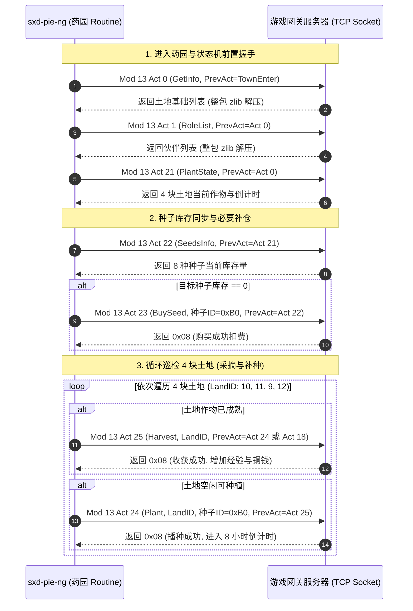

# 神仙道药园与农场系统 (Mod 13) 协议逆向与重建规范报告

> [!NOTE]
> 本文档基于对原版 `pie.exe` 运行抓包 (`sxd.pcapng`)、原版历史运行日志 (`pie-*.log`) 及 `pieb.ini` / `01.ini` 的逐字节比对，完整还原了神仙道药园/农场模块 (Module 13 / `0x000D`) 的完整生命周期、二进制报文结构、整包 zlib 压缩解压规范与状态机时序依赖。

---

## 一、 药园模块动作号字典 (Action ID Registry)

在神仙道网络二进制协议中，药园系统隶属于 **Module 13 (0x000D)**，核心动作号如下：

| Action ID | 16进制 | 协议职责 | 发送方向 | 载荷特征 |
| :--- | :--- | :--- | :--- | :--- |
| **0** | `0x000D0000` | 药园基础土地与开垦状态 (`get_herbgarden_info`) | 双向 | CLI: 4B 前序动作号<br/>SRV: 整包 zlib 压缩，土地切片 (每块 48B) |
| **1** | `0x000D0001` | 药园伙伴受培列表 (`get_role_list`) | 双向 | CLI: 4B 前序动作号<br/>SRV: 整包 zlib 压缩，伙伴信息列表 |
| **12** | `0x000D000C` | 药园仙露/祝福配置 (`get_blessing_info`) | 双向 | CLI: 4B 前序动作号<br/>SRV: 16B 属性数值 |
| **21** | `0x000D0015` | 药园种植作物状态 (`get_player_role_herbgarden`) | 双向 | CLI: 4B 前序动作号<br/>SRV: 整包 zlib 压缩，土地状态 (每块 19B) |
| **22** | `0x000D0016` | 药园种子库存与种子商店 (`get_herbgarden_seeds`) | 双向 | CLI: 4B 前序动作号<br/>SRV: 整包 zlib 压缩，8 种种子库存与单价 |
| **23** | `0x000D0017` | 购买药园种子 (`buy_herbgarden_seed`) | 双向 | CLI: 4B 种子ID + 4B 前序动作号<br/>SRV: 1B 返回码 (`0x08` 成功) |
| **24** | `0x000D0018` | 药园土地播种 (`plant_herbgarden`) | 双向 | CLI: 4B 土地ID + 4B 种子ID + 4B 前序动作号<br/>SRV: 1B 状态码 (`0x08` 成功, `0x21` 失败) + 结果体 |
| **25** | `0x000D0019` | 药园作物采摘/收获与刷新 (`harvest_herbgarden`) | 双向 | CLI: 4B 土地ID + 4B 前序动作号<br/>SRV: 1B 状态码 (`0x08` 成功, `0x21` 失败) + 经验与CD |

---

## 二、 协议帧结构与整包 Zlib 压缩机制

### 2.1 请求帧基础格式
客户端发往服务端的每个 Mod 13 请求均采用统一的大端序格式：
```
+-------------------+------------------+------------------+------------------------+
| Packet_Length(4B) |  Module_ID (2B)  |  Action_ID (2B)  |     Payload (...)      |
|  (uint32, 大端序)  |      0x000D      |    Action (2B)   |   参数列表 + 4B PrevAct  |
+-------------------+------------------+------------------+------------------------+
```

> [!IMPORTANT]
> **防外挂时序校验链 (`PrevAct`)**：
> 服务端在校验业务请求时，严格校验 Payload 末尾附带的 4 字节前序动作号（如 `0x000D0018` 或 `0x000D0019`）。若动作时序不连贯或缺少必要的前置拉取握手，服务端将拒绝执行或直接切断连接。

### 2.2 服务端整包 Zlib 压缩 (Whole-Packet Compression)
对于 Action 0、1、21、22 等包含批量列表的回包，神仙道服务端采用**整包 Deflate 压缩**：
- 包头 Length 字段表示随后的压缩字节总数；
- 紧随其后的 2 字节并非 Module_ID，而是标准 zlib 魔数 `0x78 0x9C`；
- 解压该压缩数据流后，前 4 字节为还原的 `Module_ID (2B) + Action_ID (2B)`，后续为业务数据载荷。
- 本项目 `internal/protocol/stream.go` 的 `DecompressWholePacketIfNeeded` 已原生支持此类透明自愈还原。

---

## 三、 核心接口二进制 Payload 布局还原

### 3.1 查询药园土地信息 (Action 0 / `0x000D0000`)
- **请求 Payload (4 字节)**：
  - `PrevAct` (4B uint32): 上一个动作号（如 `0x00010000` 进入城镇，或 `0x000D0006`）。
- **响应 Payload (解压后)**：
  - `Count` (2B uint16): 土地数量（常规玩家为 4 块土地）。
  - `Lands` 切片：每块土地固定占 **48 字节**：
    - `0..3` (4B int32): `LandID` 土地编号（如 9, 10, 11, 12）。
    - `4..39` (36B): 土地养成、升级等级、红土地/黑土地标志与增益位。
    - `40..43` (4B): 种植状态掩码与作物分类。
    - `44..47` (4B int32): 土地附加属性或角色培养槽。
  - `Trailing` (4B int32): 尾随校验字段（常为 `0x00000064` = 100）。

### 3.2 药园种植作物状态 (Action 21 / `0x000D0015`)
- **请求 Payload (4 字节)**：
  - `PrevAct` (4B uint32): 通常为 `0x000D0000` (Action 0)。
- **响应 Payload (解压后)**：
  - `Count` (2B uint16): 土地数量（4）。
  - `LandStates` 切片：每块土地固定占 **19 字节**：
    - `0..3` (4B int32): `LandID`（10, 11, 9, 12）。
    - `4..11` (8B): 生长倒计时 (秒) 与播种时间戳。
    - `12..15` (4B int32): 种植的种子 ID（未种植时为 0）。
    - `16..18` (3B): 状态标记（`0x01` 表示地块已解锁可用）。
  - `Trailing` (4B int32): 尾随校验字段（`0x00000064`）。

### 3.3 药园种子库存与商店 (Action 22 / `0x000D0016`)
- **请求 Payload (4 字节)**：
  - `PrevAct` (4B uint32): 通常为 `0x000D0015` (Action 21)。
- **响应 Payload (解压后)**：
  - `Count` (2B uint16): 种子项数量（8 种常用种子）。
  - 8 项连续结构（每项 20 字节）：
    - `SeedID` (4B int32): 种子标识（如 `0xA9`=169 仙玲珑经验草、`0xB0`=176 经验丹果树、`0xAF`=175、`0xAB`=171、`0xAE`=174、`0xAD`=173、`0xAC`=172、`0xAA`=170）。
    - `OwnedCount` (4B int32): 玩家当前拥有的该种子存量。
    - `PriceType` (4B int32): 货币类型（`3` 代表铜钱）。
    - `Price` (4B int32): 购买单价（例如 `1500000` 铜钱）。
    - `Reserved` (4B): 保留扩展位。

### 3.4 购买种子 (Action 23 / `0x000D0017`)
- **请求 Payload (8 字节)**：
  - `SeedID` (4B int32): 欲购买的种子编号（如 `0x000000B0`）。
  - `PrevAct` (4B uint32): 通常为 `0x000D0016` (Action 22)。
- **响应 Payload (1 字节)**：
  - `Status` (1B uint8): `0x08` 代表购买成功并扣除对应铜钱；`0x21` 代表铜钱不足或已达上限。

### 3.5 药草采摘与收获 (Action 25 / `0x000D0019`)
- **请求 Payload (8 字节)**：
  - `LandID` (4B int32): 目标土地编号（如 9, 10, 11, 12）。
  - `PrevAct` (4B uint32): 关联前序动作号（如 `0x000D0018` 或 `0x000D0015`）。
- **响应 Payload**：
  - 若已成熟采摘成功 (23 字节)：
    - `Status` (1B): `0x08` (成功)
    - `SuccessFlag` (2B uint16): `0x0001`
    - `LandID` (4B int32): 土地编号
    - `GainExp` (4B int32): 产出经验值
    - `GainCoins` (4B int32): 产出铜钱
    - `Cooldown` (4B int32): 下一次冷却时长（如 28800 秒 / 8 小时）
  - 若未成熟或地块为空 (7 字节)：
    - `Status` (1B): `0x21` (状态未成熟/无需采摘)
    - 尾随 6 字节全 0。

### 3.6 土地播种药草 (Action 24 / `0x000D0018`)
- **请求 Payload (12 字节)**：
  - `LandID` (4B int32): 目标土地编号。
  - `SeedID` (4B int32): 选用的种子编号（如 `0x000000B0`）。
  - `PrevAct` (4B uint32): 前序动作号（采摘后播种传 `0x000D0019`）。
- **响应 Payload**：
  - 若播种成功 (15~27 字节)：
    - `Status` (1B): `0x08` (成功)
    - `LandID` (4B int32): 土地编号
    - `SeedID` (4B int32): 播下的种子编号
    - `SuccessFlag` (4B int32): `0x00000001`
  - 若播种失败/地块被占 (15 字节)：
    - `Status` (1B): `0x21` (地块未成熟或无空地)

---

## 四、 状态机标准交互时序图 (Full Sequence Workflow)



---

## 五、 与旧版实现差异与重构点清点

1. **废除伪造的 PrevAct 猜测**：旧版实现中将 `PrevAct` 随意硬编码为常量，导致服务端校验断链；新规范严格建立链式传递（如 Act 21 承接 Act 0，Act 22 承接 Act 21，Act 23 承接 Act 22，Act 24 承接 Act 25）。
2. **修正土地回包切片大小**：
   - Act 0 土地切片实际为 **48 字节**，修正了旧代码中单地块按 16 字节反序列化导致的字段错位崩溃。
   - 新增 Act 21 精准生长倒计时解码（每地块 19 字节）。
3. **补全自动买种子时序 (Act 22 -> Act 23)**：旧版直接发 Act 24 播种，若背包或药园种子库存为 0 则直接触发服务端错误；重构版引入 Act 22 探查与 Act 23 自动补仓机制。
4. **统一状态码判定**：服务端成功为 `0x08`，跳过/失败为 `0x21`，替代原先无根据的 `uint8(1)` 判定。
