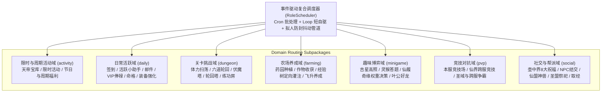
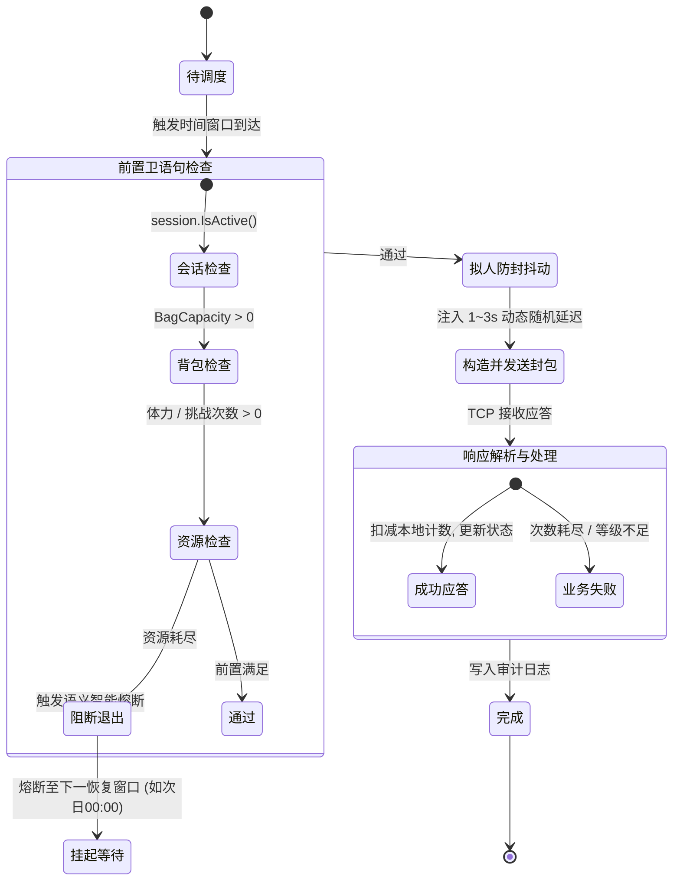

# 玩法子系统与自动化规则规范白皮书 (Routine Specification)

> [!NOTE]
> 本白皮书全面对齐原版 `pieb.ini` 与 `01.ini` 的调度逻辑，定义七大领域包（`activity`, `daily`, `dungeon`, `farming`, `minigame`, `pvp`, `social`）中具体玩法的状态机生命周期、前置卫语句检查、发包时序与语义智能熔断契约。

---

## 一、 领域包与玩法架构映射矩阵



| 领域包名称 | 对应目录 | 覆盖原版 `pieb.ini` / 扩展玩法模块 | 调度类型 | 优先级阶段 |
| :--- | :--- | :--- | :--- | :--- |
| **`activity`** | `internal/routines/activity` | 限时周期活动、天帝宝库自选大奖与节庆福利 | `ScheduleCron` | Standard / Low |
| **`daily`** | `internal/routines/daily` | `[日常]` 签到、小助手、邮件、VIP俸禄、称号、命格 | `ScheduleCron` (00:00, 06:02) | High / Normal |
| **`dungeon`** | `internal/routines/dungeon` | `[动作] 扫荡`、`[01.ini 扫荡]`、六道/伏魔/轮回塔 | `ScheduleLoop` (30m 周期) / `ScheduleCron` | Normal |
| **`farming`** | `internal/routines/farming` | `[农场]` 土地种植、作物收获、伙伴灌注、灵宠/飞升养成 | `ScheduleLoop` (15m 周期) / `ScheduleCron` | Normal |
| **`minigame`** | `internal/routines/minigame` | `[日常] 吉星高照`、`[01.ini 仙履奇缘]`、灵猴问答 | `ScheduleCron` (12:00, 18:01) | Normal / Low |
| **`pvp`** | `internal/routines/pvp` | `[日常] 本服竞技场`、`[圣域竞技]`、`[神魔大战]` | `ScheduleCron` (12:00, 20:01) | Normal |
| **`social`** | `internal/routines/social` | `[壶中界]`、`[仙盟]`、`[圣盟]`、`[结婚]`、`[取经]` | `ScheduleCron` (08:02, 22:01) | High / Normal |

---

## 二、 核心任务状态机与生命周期标准

所有日常活动任务必须严格遵循统一的状态机流转，禁止跳过前置卫语句检查：



### 2.1 语义智能熔断机制 (Semantic Cooling-off)
- **拒绝无谓重试**：当执行中服务端返回特定错误码（例如：`体力不足`、`今日挑战次数已用完`、`等级未达到解锁要求`）时，该 Routine 必须立即进入 **语义智能熔断状态**。
- **自动对齐恢复窗口**：系统将任务挂起至下一个逻辑重置时间点（如次日 `00:00`，或根据体力回复速率计算的具体时刻），而非在短时间内频繁重试消耗带宽与触发防挂检测。
- **定点批量唤醒不得提前拉起语义冷却**：Routine 返回 `CooldownError` / `ErrAttemptsExhausted` / 体力或背包熔断后，调度器记录 `holdUntil`；`TriggerBatch`（`cron_times` 定点批量唤醒）在 `holdUntil` 到期前必须跳过该任务，否则「冷却结束再唤醒」「活动开启后再唤醒」的语义会被盘中重置覆盖（2026-11-16 18:01 魔王试炼 4 小时冷却被 18:01 批量唤醒抹掉、44 分钟后重复请求的实例）。到期后批量唤醒自动恢复，执行成功时清除 `holdUntil`。
- **功能开放状态必须原生探测**：新增玩法在发业务请求前，先用 `RoleSession.CheckFunctionOpen` 调用 `Mod_Player_Base.check_function_open`（Module 0, Action 69），功能编号取自客户端 `FunctionTypeData.List`。回包 `TRUE=119` 才继续；`FALSE=120` 记 `INFO` 后跳过；未知标志位或协议异常按失败处理。禁止用“业务请求超时”反推功能未开放。若需要一次性获取全部已开放功能，可改用 `get_player_function`（Module 0, Action 6），其回包为 `[Int id, Byte isPlayed]` 列表。
- **静默无回包的边界**：仅当原生探测本身无回包时，才按会话异常记录 `WARN` 并跳过本轮；主服只读探测必须使用独立短超时（见 `SessionConfig.SectQueryTimeout`），不得占用城镇/跨服会话的长超时预算。
- **协议封装必须自带超时**：`RoleSession` 的每个协议封装方法都**不得**以调用方透传的 ctx 直接调用 `s.Call`。Routine 拿到的是调度器上下文（无 deadline），服务端静默丢包时会永久阻塞并冻结该角色的**全部**后续玩法（2026-11-10 叶公好龙 `check_function_open` 事故：调度协程挂死 24 分钟）。业务封装应设置 3~8 秒业务超时；`s.Call` 另对无 deadline 的调用兜底 30 秒，仅作最后防线。
- **连续失败/静默丢包阈值（N 次失败退出）**：同一玩法连续 N 次（默认 3）失败后必须熔断本轮并挂起，禁止把整张目标/关卡列表逐个打一遍。计数**只能在业务动作真正成功时清零**：面板、进度、功能开放等前置探测成功不得清零，否则「面板正常、业务动作被丢弃」时计数每轮被重置，永远达不到阈值（2026-11-21 飞升灌注 / 万古神墟 / 无量劫海 / 灵域猎妖 / 轮回图录 / 叶公好龙 均出现此缺陷）。达到阈值后挂起至 `min(次日 00:05, 6 小时)`，到期后自动恢复探测。
- **挑战类副本的失败口径**：战斗失败、建队被业务码拒绝、领奖失败都计入连续失败；`今日已挑战 / 已领取` 等「已完成」语义的结果码不计入失败，只跳过该目标。
- **断线与超时的重试口径（2026-11-22）**：
  - Routine 执行**中途**因会话断开返回 `client.ErrNotConnected` 时，调度器按 **90 秒**短重试，而不是把 Cron 任务推迟到下一次定点唤醒（2~4 小时）导致剩余次数漏做；会话未恢复期间调度器本身不会拉起任务（前置检查直接返回，不产生请求）。90 秒覆盖实测重连耗时中位数（主动重建 23 秒 / 被动踢线 76 秒，p90 约 111 秒）；原先的 5 分钟会让被打断的玩法空等 4 分钟以上。
  - 请求超时（`context.DeadlineExceeded` / 服务端静默丢包）且 Routine 自身没有 dropbackoff 计数时，调度器按 **30 分钟**重试；已接入 `HandleSilentDrop` 的玩法仍以「连续 3 次 → 挂起至 min(次日重置, 6 小时)」为准。
- **会话健康窗口（2026-11-24 实测）**：服务端对长会话的重型请求（无量劫海 854/1 布阵、853/3/853/4 战斗等）会在会话年龄约 4 分钟后静默丢弃甚至直接断开连接；同一批请求在登录后早期窗口内全部正常。对 87 次布阵序列的相关性分析：成功时会话年龄中位数 **6 秒**，被断开时中位数 **250 秒**。
  - 全量日志复核（172 次主会话 EOF）：**100 次是客户端主动重建**（65 次玩法入口守卫、21 次定期刷新、14 次其他），仅 72 次是服务端踢线；服务端踢线集中在登录后 **225 秒**，且 69/72 发生在 s0（持续跑玩法的角色）。主动重建后的恢复中位数 23 秒，被动踢线后 76 秒。
  - 因此**不启用周期性主动重建**（`session_refresh` 默认关闭）：它只能提前重连，无法延长服务端窗口，还会与入口守卫叠加产生重复重连和登录风控压力（650 次认证失败）。需要新会话的重型玩法在**入口**按需调用 `EnsureFreshConnection`，其余玩法接受服务端 225 秒断链并由调度器自动重连、90 秒后补做。
  - 重型 Routine 入口必须调用 `RoleSession.EnsureFreshConnection(ctx, maxAge)`：未超窗直接执行；超窗主动重建连接并等待新连接 Active；等待超时返回 `ErrNotConnected` 走 90 秒短重试。
  - 窗口按玩法实测取值：`wuliang_jiehai` 的 854/39→854/1→853/3→853/4 序列对年龄极敏感，按 **30 秒**刷新（89 次采样：<30s 29/29 成功、30–60s 2/7、>60s 3/53）；`levitate_perfusion`、`devil_expedition`、`era_rebirth_attr_gift` 使用 `client.HealthySessionAge`（3 分钟）。
  - 主动重建**必须重新换票**：网关票据一次性，复用已消费票据会连续 3 次握手超时（实测约 75 秒空窗）；`EnsureFreshConnection` 重建前先调用 `RefreshCredentials`（10 秒防抖），实测恢复时间从约 75 秒降到约 3 秒。普通断线的自愈换票仍受 2 分钟节流，避免同账号多角色互相顶号。

### 2.2 回包解析铁律（强制）

> [!IMPORTANT]
> **收到回包 ≠ 业务成功。** 任何 Routine 在发包后必须解析回包结果码，并以失败语义驱动下一步，禁止只判断网络层是否超时。

1. **禁止丢弃应答**：禁止使用 `_, _ = session.Call(...)` 丢弃带结果码的业务回包。仅心跳、纯通知或协议明确无 `result` 字段的封包可豁免，且必须在代码注释中说明协议依据。
2. **先校验结果码，再读业务数据**：失败回包可能被截断或不包含完整业务字段；在 `result_code` 未确认成功前，禁止读取或采信后续业务字段。
3. **成功值按模块定义**：不同模块的成功码不同（如 `0` / `2` / `4` / `97`），必须依据 [protocol-spec.md](./protocol-spec.md) 中对应模块的协议定义判断，严禁统一假设 `0` 为成功。
4. **失败语义必须驱动下一步动作**：

| 失败语义 | 强制处理策略 |
| :--- | :--- |
| 次数不足 / 今日已用完 | 返回 `scheduler.ErrAttemptsExhausted`，熔断挂起至次日重置。 |
| 冷却中 | 读取回包中的 `cdTimer` / 冷却字段，本轮退出并等待冷却结束；除显式配置外，严禁消耗元宝清除冷却。 |
| 条件不满足（等级、前置任务、无可领悟技能、无可挑战目标） | 返回 `scheduler.ErrConditionNotMet` 或本轮正常退出；禁止原样连续重试。 |
| 背包已满 | 返回 `scheduler.ErrBagFull`，进入短冷却。 |
| 未知错误码 | 记录 `routine`、`ActionID` 与 `result_code` 后终止本轮，禁止盲目重复发包。 |

5. **成功也要校验副作用**：成功码之外，还需校验次数是否推进、奖励是否到账、状态是否变化；出现“成功码但业务未生效”时记录告警并按失败处理。
6. **测试覆盖**：新增或修改玩法必须覆盖成功路径与至少一个失败码路径；仅验证“回包到达”的假成功测试视为无效。

### 2.3 拟人防封随机抖动 (Jitter Pipeline)
- 每次与服务端发起核心交互前，必须穿透调用 `jitter.Wait(ctx)`。
- 在 `configs/config.yaml` 中配置抖动区间（默认 `min: 1.0s, max: 3.0s`），利用泊松或高斯分布生成不可预测的操作间隔。

### 2.4 玩法工程原语与横切中间件
- **语义化优先级阶段**：所有 Routine 优先级必须使用 `scheduler.Priority*` 或 `scheduler.PhasePriority(phase, offset)`（`PhaseCleanup` / `PhaseStandard` / `PhaseHighPriority` / `PhaseEarlyWindow` / `PhaseCoreLoop` / `PhaseEarlyBattle` / `PhaseTownSensitive` / `PhaseSystem`），禁止直接填写魔数 `scheduler.RoutinePriority(NNN)`。
- **声明式生命周期选项**：战斗或跨场景结束后需要回城的玩法，统一在 `scheduler.NewBaseRoutine(...)` 末尾声明 `scheduler.WithReturnToTown()`，不再手写 `defer session.ReturnToTown(...)`；需原生功能门禁或自定义静默丢包阈值的玩法可使用 `scheduler.WithFunctionID(...)` 与 `scheduler.WithSilentDropPolicy(...)`。
- **调度器隔离丢包计数**：玩法记录/清零静默丢包必须使用上下文感知接口 `scheduler.HandleSilentDropCtx` / `ResetSilentDropsCtx` / `NoteSilentDropCtx` / `SilentDropCountCtx`，由所属 `RoleScheduler` 的独立 `DropTracker` 承载，避免全局单例互相污染。
- **统一调用与休眠原语（`internal/routines/kit`）**：
  - 玩法内统一使用 `kit.NewCaller(ctx, session, timeout)`（或 `kit.Call` / `kit.CallResync`），遇 `nil`/错误时通过 `caller.AbortErr()` 或 `kit.IsAbortErr(err)` 立即向上透传断线与取消事件，不得手写吞错局部 `call` 闭包。
  - 所有短暂停顿必须使用可中断的 `kit.Sleep(ctx, d)`，禁止在玩法中使用裸 `time.Sleep`。
  - 单元测试可使用 `kit.WithTimeoutOverride(ctx, d)` 压缩静默丢包超时，避免测试长时干等。
- **统一 PrevAct 链语义**：封包尾部 4 字节前序动作由 `protocol.PrevActMode`（`PrevActNone` / `PrevActAutoBusiness` / `PrevActExplicit`）显式声明，由 `client.PrevActChain` 统一管理锚点、链污染回退与重同步重试。

---

## 三、 六大核心玩法子系统实战规范

### 3.1 副本体力扫荡 (`dungeon_sweep`)
- **调度策略**：`ScheduleLoop`，每 30 分钟轮询一次。
- **前置检查**：
  1. `session.GetStamina() >= 5`（单次关卡基础体力消耗为 5 点）。
  2. `session.GetPlayerState().BagCapacity > 0`（防止背包满导致掉落装备损毁）。
- **关卡寻址算法**：
  1. 若配置中指定了 `TargetMissionID`，优先扫荡该关卡；
  2. 若未指定，查询本地数据库 `data/gamedata.db` 中的 `Missions` 表，按 `01.ini` 的 `从高等级扫起=是` 选取当前等级允许的最高收益 BOSS 关卡。
- **发包时序**：
  1. 发送 `Module 25, Action 1 (0x00190001)` 发起扫荡；
  2. 解析回包扣减本地体力记录。若体力不足，触发熔断挂起。

#### 3.1.1 精英副本扫荡 (`sweep_elite`)

- **协议归属**：精英/英雄副本属于 `Mod_HeroMission_Base`（**Module 35 / 0x0023**），与主线 `Module 25` 完全异构；旧实现的 `Module 111 / 0x006F` 与 `0x00230002` 主线降级均属误用，已移除。
- **实机验证的载荷布局**（`test/probes/probe_hero_practice_live.go`）：
  1. `get_hero_mission_list` (`0x00230000`)：`Uint16 town_id` + 4 字节 PrevAct；
  2. `start_practice` (`0x00230002`)：`Uint16 town_id, UByte auto_num, UByte hero_type` + 4 字节 PrevAct；
  3. `quickly` (`0x00230007`)：业务载荷为空 + 4 字节 PrevAct；
  4. `stop_practice` (`0x00230003`)：业务载荷为空 + 4 字节 PrevAct。

  > [!IMPORTANT]
  > 官方 `DataBase.netCall` 会在**每个请求**末尾追加 4 字节前序动作 (tmpBuff)。
  > 2026-11-07 实机验证：Module 35 请求省略该尾部虽能被服务端受理，但会使服务端动作链失步，
  > 导致紧接着的 Module 2 `player_sell_item` 被静默丢弃（8 秒无回包），精英扫荡物因此全部出售失败。
  > 所有 Module 35 构造器必须写入 4 字节占位并设置 `HasPrevAct=true`，由会话层在发包时填充真实动作号。
- **结果码分流**：`3=SUCCESS`、`6=BAG_FULL`、`7=NOT_ENOUGH_POWER`、`8=NO_MISSION`、`4=NOT_ENOUGH_INGOT`。收到 `4` 必须立即停止，避免误消耗元宝。
- **城镇全量覆盖**：扫荡入口是城镇而非单个副本实例；`data/gamedata.db` 中 `Missions.MissionType=1` 的 `map` 去重即为全部精英副本城镇。自动化逐城镇执行 `list -> start_practice -> quickly`，不设本地轮数上限；体力与每日次数由服务端熔断。
- **自动出售**：每个城镇结束后对比背包 `PlayerItemID -> Field5 数量` 基线，卖出新增格位；已有格位数量增加时，仅对精英副本主要掉落类型（`item.type_id=1002` 制作卷）整格出售，避免误卖玩家原有的包子/粽子/茶叶蛋等消耗品库存。刚结束扫荡时首个出售请求可能超时，需以 8 秒超时并短暂等待后重试一次。背包满时先 `stop_practice` 并卖出已结算掉落，再重试当前城镇；仍无法腾出空间才返回 `scheduler.ErrBagFull`。
- **瞬时超时**：单个城镇的列表/扫荡请求超时需短暂退避后重试（最多 4 次），避免偶发网络抖动导致整座城镇漏扫。

### 3.2 药园农场 (`herb_garden`)
- **调度策略**：`ScheduleLoop`，每 15 分钟巡视一次。
- **发包时序**：
  1. **查询状态**：发送 `Module 13, Action 0 (0x000D0000)`，获取 6 块土地的成熟计时；
  2. **收获作物**：遍历所有成熟土地，依次发送 `Module 13, Action 25 (0x000D0019)`；
  3. **重新种植**：对空闲土地，读取 `pieb.ini [农场]` 配置的种子优先级（经验丹果树、奇异果树、道源果树），并指派配置中的主力伙伴（如神夸父、伏羲等），发送 `Module 13, Action 24 (0x000D0018)`。

### 3.3 仙旅奇缘事件抉择 (`travel_event`)
- **调度策略**：`ScheduleCron`，每日 `12:00` 与 `18:01` 触发。
- **智能决策流**：
  1. 发送 `Module 21, Action 0 (0x00150000)` 查询今日已参与次数 `joinCount` 与总次数 `totalCount`；
  2. 发送 `Module 21, Action 1 (0x00150001)` 拉取当前随机事件、故事文本与分支选项；
  3. **三级漏斗检索**：
     - 在 `data/answers.txt`（GBK 编码 JSON）建立的内存哈希索引中匹配故事文本；
     - 按 `01.ini [仙履奇缘]` 的收益优先级规则决策：`体力 > 声望 > 阅历 > 铜钱`；
     - 命中失败时回退到官方首个分支；
  4. 发送 `Module 21, Action 2 (0x00150002)` 提交 `eventId + answerId`（严格 8 字节，不带 PrevAct）；
  5. 以回包中的 `joinCount` 推进循环；若次数未推进或 `cdTimer > 0` 则立即熔断退出，不主动消耗元宝消除冷却。

### 3.4 竞技场挑战 (`arena_challenge`)
- **调度策略**：`ScheduleCron`，对齐每日奖励结算时间（`12:00` 与 `20:01`）。
- **策略过滤**：
  1. 发送 `Module 28, Action 13 (0x001C000D)`，确认剩余挑战次数 > 0；
  2. 发送 `Module 28, Action 0 (0x001C0000)`，拉取当前 5 位候选对手；
  3. **软柿子筛选算法**：根据 `01.ini [仙界竞技场] 对手战力上限`，优先选择排位最靠前、且战斗力低于玩家当前战力的对手；
  4. 发送 `Module 28, Action 1 (0x001C0001)` 发起挑战。

### 3.5 壶中界祝福与结交 (`pot_refinement`)
- **调度策略**：`ScheduleCron`，每日 `08:02` 与 `22:01` 执行。
- **业务动作**：
  1. 维持 8 大核心祝福（取经、宠物、觉醒、虚空、魔石、五行、仙桃、种植祝福）；当剩余有效时间小于 4000 秒时重新炼化；
  2. 自动与 10 位仙界 NPC（土地公、陆吾、柳如烟、月老、芸娘等）批量送礼结交，消耗配置指定的货币（道源）。

### 3.6 仙界练功房 (`training_room`)
- **调度策略**：`ScheduleLoop`，每 60 分钟巡检一次。
- **跨服链路**：`Mod 96` 申请凭据 → `Mod 94` 登录仙界节点 → `Mod 95` 进入仙界城镇 → `Mod 117` 练功房业务。
- **前置卫语句**：`enter_room` 返回 `FUNCTION_NO_OPEN (8)` 时返回 `scheduler.ErrConditionNotMet` 熔断本轮；跨服凭据不可用时静默跳过，不阻断主服任务。
- **状态机**：
  1. `get_rooms` 读取各房间人数、当前练功标记与所在品质；
  2. 按 5→1 星查找 `count < 固定席位数` 的房间，再以 `get_room_info` 核对真实空闲席位（固定席位数见协议规范 4.14）；
  3. 当前房间收益不低于所有候选时原地领取经验，不反复换座；
  4. 需要换房时严格按官方顺序执行 `player_leave_seat` → `get_room_practice_exp` → `get_seat_info` → `sit_down`；
  5. 星级席位在查询与入座之间被抢占时继续尝试下一空位，全部失败后回落普通练功场（品质 100）。
- **严格载荷约束**：`get_room_info` / `sit_down` / `get_seat_info` / `rob_the_seat` / `get_free_room_info_by_page` 必须发送精确长度的纯业务载荷，**禁止追加 `PrevAct`**（追加会被服务端静默丢弃）；其余空载荷动作可携带 `PrevAct`。
- **资源约束**：默认 `allow_rob_seat=false`，只占空闲席位；开启后按对手战力升序抢夺满员高星房间，且每次争夺后重新 `get_rooms` 确认归属。永不调用 `buy_rob_time` / `clean_rob_cd_time`，不消耗元宝。

---

## 四、 存量代码迁移与接口对接契约

针对现有 `internal/routines/` 中仅包含空日志的半成品，在后续重构推进时统一遵循本契约：

```go
// 规范化打桩示例 (对齐 internal/routines/daily/daily.go)
func NewSignInRoutine() scheduler.ActivityRoutine {
    return scheduler.NewBaseRoutine(
        "daily_sign_in",
        "daily",
        scheduler.ScheduleCron,
        scheduler.PriorityHigh,
        0,
        func(ctx context.Context, session *client.RoleSession, jitter *scheduler.Jitter) error {
            if session == nil {
                return client.ErrNotConnected
            }
            if jitter != nil {
                _ = jitter.Wait(ctx)
            }
            
            // TODO(Ateng): 发送 Module 0, Action 2 确认角色基础属性
            // TODO(Ateng): 发送 Module 0, Action 72 获取每日签到奖励状态并提交签到请求
            slog.Info("正在执行日常任务: 每日签到与在线福利领取", "role_id", session.RoleID())
            return nil
        },
    )
}
```

> [!CAUTION]
> 上述代码仅用于展示 Routine 骨架，**不得作为业务实现的完成标准**。提交业务实现前必须补齐回包 `result_code` 解析、失败语义分流与对应测试，否则视为未完成。
